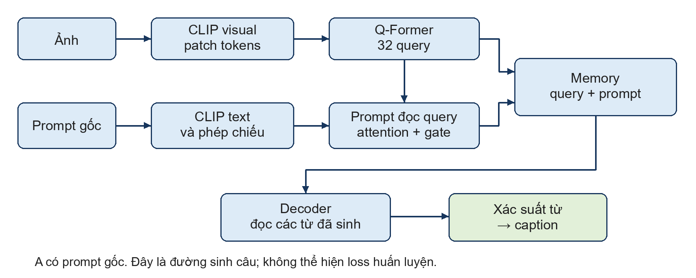
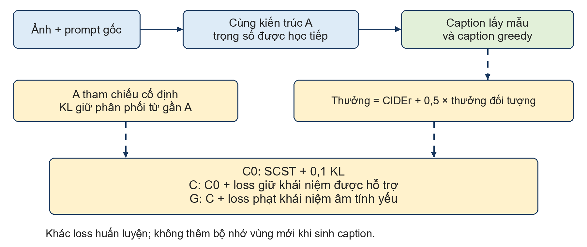
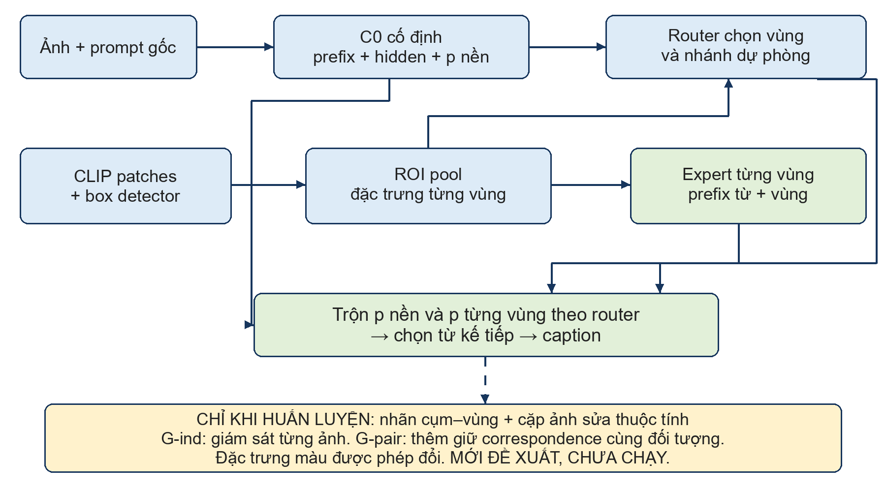

# Báo cáo tuần bản trình thầy 4 trang

BÁO CÁO KẾT QUẢ TUẦN

Từ ngày 25 đến ngày 31 tháng 10 năm 2026

1 Công việc trong tuần và pipeline nền

Trong tuần, em kiểm tra nhiều cách đưa thông tin thị giác vào mô hình sinh caption, với mục tiêu tăng CIDEr và giảm ảo giác đối tượng. Kết quả nổi bật là C và C0 tăng CIDEr so với nền A trên 4.000 ảnh; mức giảm ảo giác chưa có bằng chứng đủ chắc chắn. Em giữ kết quả này và đề xuất hướng căn chỉnh vùng–cụm để trao đổi tiếp với thầy.

Pipeline nền A

A là checkpoint nền đã có, dùng cả ảnh và prompt gốc. CLIP trích xuất đặc trưng ảnh; Q-Former tạo 32 query. Prompt đọc query qua attention và gate, sau đó cùng các query tạo memory cho decoder sinh caption. Những pipeline thử nghiệm trong tuần đều được so với mốc này hoặc C0.

Các nhóm công việc đã hoàn tất

Nhóm công việc | Kết quả và quyết định
Chọn cặp caption ưu tiên | Sinh 10.000 ứng viên trên 2.000 ảnh. Chỉ 13/30 cặp ưu tiên tự động được em đồng ý sau kiểm tra; dừng recipe tạo nhãn này.
Prompt và query thị giác | 138 ảnh có tín hiệu attention theo danh từ, nhưng tăng mass trong box chưa giúp decoder sinh từ đúng hơn. C/T với prompt không phù hợp giảm CIDEr hoặc recall; chưa mở rộng.
Loss hỗ trợ thị giác C/H/T | Ba nhánh hoàn tất 500 bước. T chưa hơn A hoặc H; chưa đạt mức hỗ trợ thị giác mong muốn.
Quan hệ và bộ đọc vùng | Chuẩn bị 256 cặp train và 64 cặp đánh giá. RelContrast chỉ hơn RelPos 1/64 cặp. I/J và D/E chưa vượt mốc nền tương ứng.
Khái niệm và ảnh chỉnh sửa | Chạy C/G/C0, đánh giá thêm 4.000 ảnh; xác nhận 15 cặp ảnh để kiểm tra phản ứng Changed/Stable. Kết quả ở các trang tiếp theo.

2 Nhóm C0 C G và kết quả chính

Ba nhánh giữ kiến trúc suy luận của A và khác mục tiêu huấn luyện. C0 tiếp tục SCST cùng KL bám A; C thêm loss giữ khái niệm được hỗ trợ; G thêm phạt khái niệm âm tính yếu. C và T ở các nhóm thí nghiệm khác không phải những cấu hình trong nhóm này.

SCST dùng chênh lệch thưởng giữa caption lấy mẫu và greedy; thưởng gồm CIDEr và thưởng đối tượng hệ số 0,5. KL hạn chế lệch phân phối từ so với A. Loss giữ và phạt khái niệm là các thành phần bổ sung; nhãn âm yếu không bảo đảm vật thực sự vắng mặt trong ảnh.

Đánh giá cùng checkpoint trên 4000 ảnh bổ sung

Mô hình | CIDEr ↑ | Câu ảo giác ↓ | Lượt nhắc sai / tổng | Recall ↑
A | 1,189771 | 239 / 4.000 | 254 / 6.484 | 46,81%
C0 | 1,204560 | 235 / 4.000 | 248 / 6.502 | 47,11%
C | 1,207042 | 230 / 4.000 | 243 / 6.477 | 47,03%

C tăng CIDEr 0,017271 so với A, khoảng tin cậy bootstrap 95% [0,008819; 0,025853]. C0 tăng 0,014789, khoảng tin cậy [0,006063; 0,023629]. Tuy nhiên, C−C0 chỉ 0,002481 và khoảng tin cậy còn chứa 0. Vì vậy, chưa thể quy lợi ích riêng cho loss giữ khái niệm; phần tiếp tục SCST và KL đã giữ được mức tăng CIDEr.

C có ít hơn A 9 câu bị CHAIR đánh dấu và 11 lượt nhắc đối tượng sai. Đây là mức giảm quan sát được, nhưng kiểm định về hallucination chưa qua điều kiện đã đặt. CHAIR chỉ chấm ảo giác đối tượng, không chấm đầy đủ sai màu và quan hệ. Các kết quả mới có một seed và validation từng được sử dụng, chưa thay cho test độc lập.

Các kết quả dev1000 để đối chiếu

Trên cùng dev1000: A đạt CIDEr 1,2055 với 52 câu bị CHAIR đánh dấu; C đạt 1,2257/51 câu; G đạt 1,2295/52 câu; C0 đạt 1,2307/52 câu. D/E khởi tạo từ C0 đạt 1,2288/60 câu và 1,2210/55 câu nên chưa được mở rộng. Không so trực tiếp CIDEr của dev1000 với bảng 4.000 ảnh vì khác tập và IDF.

3 Kiểm tra phản ứng trên ảnh thay đổi thuộc tính

Sau khi kiểm tra các mô tả nguồn và ảnh chỉnh sửa, em đã xác nhận 15 cặp duy nhất. Mỗi cặp có một phát biểu đúng trước sửa, một phát biểu đúng sau sửa, một fact vẫn đúng và một phương án sai. Nhãn do trợ lý đề xuất rồi em xác nhận; đây không phải đánh giá mù độc lập. Các mô tả nguồn sai hoặc chỉnh sửa lan được giữ lịch sử và loại khỏi tập xác nhận.

Cách đánh giá

Giữ cố định C0 và cho ảnh gốc, ảnh sửa đi qua cùng prompt gốc. Dùng xác suất của chính decoder để so hai cụm Changed, rồi kiểm tra hai cụm Stable; đồng thời xuất caption greedy thực tế. Changed là phần đã đổi, chẳng hạn xe buýt đỏ thành xanh. Stable là phần vẫn đúng, chẳng hạn ô tô khác trong ảnh vẫn đỏ. Không huấn luyện thêm trong phép kiểm này.

Nội dung kiểm tra trên 15 cặp | Số cặp
Điểm của cụm Changed dịch chuyển đúng chiều | 14 / 15
Ưu tiên đúng Changed ở cả ảnh gốc và ảnh sửa | 7 / 15
Ưu tiên đúng Stable ở cả hai ảnh | 9 / 15
Đồng thời đạt cả Changed và Stable | 4 / 15
Caption greedy khác chữ giữa hai ảnh | 13 / 15

Lượt v2 hoàn tất đủ 15 cặp. Kiểm tra 109 tensor khớp checkpoint, trọng số không đổi trước/sau và sanity cùng đầu vào đều đạt. Lỗi v1 do so digest wrapper với riêng mô hình nền đã được sửa; kết quả báo cáo chỉ dùng lượt v2 hoàn tất.

Điều rút ra

C0 có phản ứng với ảnh, nhưng dịch chuyển điểm đúng chiều chưa có nghĩa ưu tiên mô tả đúng trên cả hai ảnh. Chỉ 4/15 cặp đồng thời đạt Changed và Stable. Kết quả này cho thấy khoảng trống để nghiên cứu tính chọn lọc, chưa xác định nguyên nhân là nhầm vùng hay chứng minh loss mới sẽ sửa được.

Caption không nhắc màu không tự là caption sai; caption khác chữ cũng không tự là tốt hơn. Ví dụ một caption chỉ nói người cưỡi voi có thể vẫn đúng khi áo người đó đổi màu. Vì vậy, các điểm cụm cho sẵn và chất lượng câu tự sinh phải được báo riêng. Bộ 15 cặp đã chọn có chủ đích, nghiêng về đổi sang màu xanh và chỉ là tập phát triển; không dùng lại làm bằng chứng tổng quát hóa độc lập.

Dữ liệu và kiểm tra đã chuẩn bị

Hoàn tất kiểm tra 32 phát biểu quan hệ và box, chốt 16 đúng/16 sai; panel caption quan hệ có 175 đánh giá, trong đó 17 được em xác nhận và 158 vẫn là đánh giá trợ lý. Phát hiện cách dùng ride=0 của V-COCO để phủ định mọi câu “riding” là không phù hợp, nên dừng recipe đó. Các cache và checkpoint cần dùng lại đã được lưu theo version Kaggle, kèm protocol, mã nguồn GitHub và bảng theo dõi kết quả.

4 Hướng căn chỉnh vùng và cụm được đề xuất

Hướng X018 đề xuất liên kết trực tiếp cụm đang sinh với vùng ảnh tạo bằng chứng. Cơ chế grounded generation là phần kế thừa. Phần cải tiến dự kiến là giữ liên kết với cùng đối tượng qua cặp ảnh thay đổi thuộc tính, trong khi cho đặc trưng và từ chỉ thuộc tính thay đổi theo ảnh. Đây mới là thiết kế để trình thầy, chưa triển khai hoặc xác nhận tính mới.

Căn chỉnh diễn ra ở đâu

Từ patch CLIP và box detector, ROI pooling lấy đặc trưng từng vùng. Router chọn trọng số cho các vùng và nhánh nền; expert của vùng trực tiếp tạo phân phối từ để trộn với phân phối nền. Đường vùng → expert → xác suất từ được dùng ngay khi sinh caption. Với xe buýt đổi đỏ sang xanh và ô tô vẫn đỏ, mô hình cần giữ đúng vùng của từng vật, thay vì ép đặc trưng hoặc cả câu bất biến.

Phép kiểm tiếp theo

Kiểm khả thi nhãn box–cụm trên tối đa 6 cặp trước khi thu thêm dữ liệu. Nếu được duyệt, so G-ind học grounded generation từng ảnh độc lập với G-pair cùng cấu hình nhưng thêm ràng buộc correspondence qua hai ảnh; mọi nhãn và ngân sách còn lại giữ giống nhau. Kiểm bằng cách thay riêng đặc trưng vùng và đo token tương ứng, đồng thời xem mô hình có bỏ qua vùng để dùng nhánh nền hay không.

Chốt khác biệt với nghiên cứu gần nhất trước khi nhận là đóng góp mới. Đánh giá caption tự sinh, CIDEr, CHAIR, recall và độ dài trên tập tách theo nguồn; chỉ sửa màu hoặc tăng điểm probe chưa đạt mục tiêu kép. Bước này chưa được chạy và cần chốt dữ liệu, tham số cùng số giờ GPU hiện tại trước triển khai.

Chi tiết và nguồn số liệu: [Bản đầy đủ](WEEKLY_REPORT_2026-10-31.md). Word local: Bao_cao_tuan_31_10_2026_rut_gon.docx. Đã kiểm tra trực quan4trang,giữ3pipeline;khôngthaykếtquảthínghiệm.
