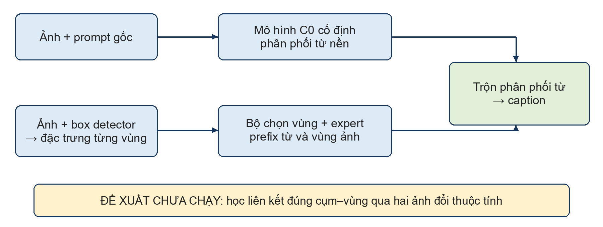

# Báo cáo tuần bản trọng tâm 3 trang

BÁO CÁO KẾT QUẢ TUẦN

Từ ngày 25 đến ngày 31 tháng 10 năm 2026

1 Công việc chính đã thực hiện

Trong tuần, em tập trung cải thiện chất lượng caption và giảm việc nhắc đến đối tượng không có trong ảnh. Đã có mức tăng CIDEr so với mô hình nền A, nhưng chưa xác nhận được mức giảm ảo giác đủ chắc chắn. Hướng tiếp theo là đưa bằng chứng vùng ảnh trực tiếp vào quá trình sinh từ.

Mô hình nền A

A dùng CLIP để lấy đặc trưng ảnh, Q-Former để tạo các query thị giác và decoder để sinh caption. Prompt gốc được kết hợp với thông tin ảnh trước khi đưa vào decoder. Đây là mô hình làm mốc so sánh, không phải mô hình chỉ nhận ảnh mà không có prompt.

Các việc đã làm trong tuần

• Thử bổ sung tín hiệu attention, vùng ảnh và quan hệ vào mô hình. Các cấu hình này chưa cải thiện đủ rõ so với mốc nền nên chưa mở rộng huấn luyện.

• Huấn luyện các nhánh C0/C/G và đánh giá thêm trên 4.000 ảnh để kiểm tra lợi ích của các loss giữ và phạt khái niệm.

• Kiểm tra 15 cặp ảnh thay đổi thuộc tính. Mô hình có phản ứng với thay đổi ảnh, nhưng chưa luôn ưu tiên đúng phần thay đổi và phần giữ nguyên. Đây là kiểm tra bước đầu, chưa phải kết quả cải thiện caption.

• Đối chiếu tài liệu và xây dựng hướng vùng–cụm có đường tác động trực tiếp đến xác suất sinh từ, trình bày ở trang 3.

2 Kết quả quan trọng nhất

Nhóm C0 C G

Ba nhánh giữ kiến trúc sinh caption của A và khác nhau ở cách huấn luyện. C0 tiếp tục SCST và KL; C thêm loss giữ khái niệm được dữ liệu hỗ trợ; G thêm loss phạt khái niệm âm tính yếu.

SCST học từ chênh lệch thưởng giữa câu lấy mẫu và câu greedy. KL giúp mô hình không lệch quá xa A. C/G có thêm ràng buộc khái niệm, nhưng không thêm một module căn chỉnh vùng–cụm khi sinh caption.

Kết quả trên cùng 4000 ảnh đánh giá

Mô hình | CIDEr càng cao càng tốt | Caption bị CHAIR đánh dấu
A nền | 1,1898 | 239 / 4.000
C0 tiếp tục SCST và KL | 1,2046 | 235 / 4.000
C thêm giữ khái niệm | 1,2070 | 230 / 4.000

CIDEr của C và C0 tăng so với A; khoảng tin cậy của hai mức tăng đều lớn hơn 0 trên tập đánh giá này. Tuy nhiên, C chưa hơn C0 đủ chắc chắn, nên chưa thể quy phần tăng điểm cho loss giữ khái niệm. Nhánh G cũng chưa cho thấy lợi ích riêng trong lượt thử trước đó.

C giảm 9 caption bị CHAIR đánh dấu so với A, nhưng mức giảm này chưa đạt điều kiện kiểm định đã đặt. Vì vậy, kết quả đạt được là cải thiện CIDEr; mục tiêu giảm ảo giác đối tượng vẫn cần nghiên cứu tiếp. Các lượt mới có một seed và sử dụng validation đã từng đánh giá, chưa phải kiểm chứng trên test độc lập.

CHAIR là công cụ kiểm tra đối tượng được nhắc sai trong caption; không đánh giá đầy đủ lỗi màu hoặc quan hệ. Các số trên không chứng minh đã có một cơ chế căn chỉnh mới hiệu quả.

3 Hướng đề xuất để trao đổi với thầy

Căn chỉnh cụm mô tả với vùng ảnh khi sinh từ

Kế thừa mô hình nền và cơ chế sinh từ dựa trên vùng ảnh. Phần cải tiến dự kiến là giữ liên kết giữa cụm mô tả với cùng đối tượng qua cặp ảnh thay đổi thuộc tính, trong khi cho đặc trưng và từ chỉ thuộc tính đổi theo ảnh. Hướng này mới ở mức thiết kế, chưa huấn luyện hoặc xác nhận tính mới.

Cơ chế căn chỉnh

Từ đặc trưng CLIP và box detector, lấy đặc trưng của từng vùng. Một bộ chọn xác định các vùng cần đọc; nhánh sinh từ theo vùng dùng đặc trưng vùng cùng các từ đã sinh để tạo phân phối từ. Phân phối này được kết hợp với phân phối nền để sinh caption. Như vậy, vùng ảnh tham gia trực tiếp vào xác suất từ, thay vì chỉ tạo một điểm đánh giá phụ.

Ví dụ xe buýt đổi đỏ sang xanh nhưng ô tô vẫn đỏ: cụm mô tả xe buýt cần tiếp tục đọc vùng xe buýt và cập nhật màu; cụm mô tả ô tô phải đọc đúng vùng ô tô. Không ép hai ảnh có đặc trưng giống nhau hoặc hai caption giống từng chữ.

Bước tiếp theo

Kiểm khả thi nhãn cụm–vùng trên một số cặp nhỏ, sau đó so sánh hai bản có cùng dữ liệu và mô hình: bản học liên kết từng ảnh độc lập, và bản thêm ràng buộc liên kết qua hai ảnh. Kiểm tra việc thay đặc trưng vùng có tác động đúng từ tương ứng hay không; đồng thời đánh giá caption tự sinh, CIDEr và CHAIR trên ảnh thật.

Trước khi triển khai, cần làm rõ khác biệt với nghiên cứu gần nhất và chốt dữ liệu huấn luyện. Mục tiêu là kiểm chứng một cải tiến căn chỉnh cụ thể; chưa khẳng định phương pháp mới hoặc kết quả tốt hơn khi chưa thực nghiệm.

## Sơ đồ dùng trong bản Word

Nguồn số liệu và lịch sử đầy đủ: [báo cáo chi tiết](WEEKLY_REPORT_2026-10-31.md). Bản Word trình thầy hiện là3trang: Bao_cao_tuan_31_10_2026_rut_gon.docx;đãrender/kiểmtra,thaybản4trangtheoyêucầuchỉgiữtrọngtâm.
