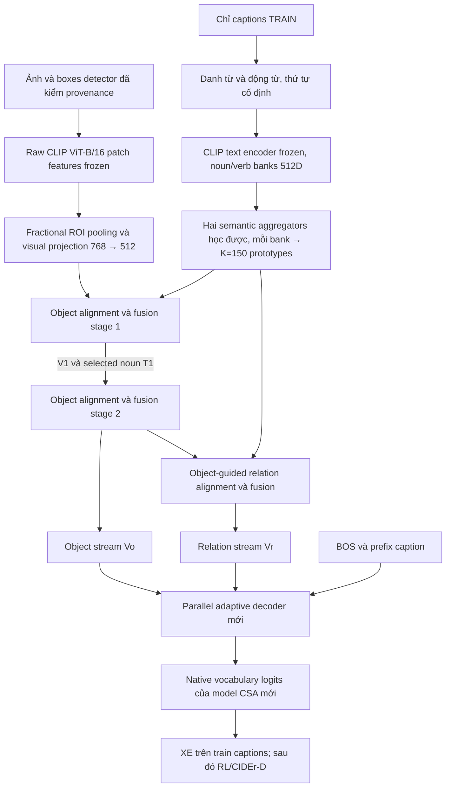

# Đặc tả triển khai CSA theo bài báo — bàn giao X024

01/11/2026, giờ Việt Nam. Base `af175c12b8471cb6d3d71090c0095412a3468104`. Người lập: Codex2; người phản biện và thực hiện: Codex1; người chạy Kaggle và quyết định ngân sách/phạm vi: user.

## Tóm tắt quyết định

Tự viết một captioner **theo cơ chế CSA trong paper**, gồm semantic aggregation, hai stage object, một stage relation và parallel adaptive decoder. Đầu vào thay thế: detector boxes hiện có + pooling theo ROI trên raw CLIP patch features; không dùng Q-Former/native decoder/prompt của C0. Noun/verb banks tự tạo từ captions TRAIN bằng CLIP text encoder frozen. Dùng cosine, gate và mixing theo công thức paper; công bố các quy ước paper chưa chỉ rõ. Đây là implementation với feature/text encoder thay thế, **không exact full-system reproduction, không claim đạt điểm paper và không là phương pháp mới**.

Thứ tự: khóa spec → audit metadata/nguồn tài nguyên → module mới/fixtures → user-run Kaggle smoke → bounded pilot → lên lịch training tham chiếu theo quota hiện tại. **Lượt X024 chỉ lập kế hoạch và sửa tài liệu**, chưa tạo modules, trainer, cache, dataset hoặc notebook mới; không chạy Torch/autograd/model/scorer. X020 được gác lại, không đưa interchange hoặc loss mới vào CSA.

## 1. Nguồn và mức đã đọc

- Paper: Jingyu Li et al., *Cascade Semantic Prompt Alignment Network for Image Captioning*, IEEE TCSVT34(7),5266–5281,2024, DOI [10.1109/TCSVT.2023.3343520](https://doi.org/10.1109/TCSVT.2023.3343520).
- User đã gửi PDF trong chat lượt này. SHA256 khớp audit cũ: `63ae0db0ee4a1eeeb41a4a241a5ff186bae342caf180fe7e5b2d2875d86575eb`. Đã trực tiếp đọc §III-A–E/Eq.(1)–(19), §IV-A/B và xem render PDFp5–6 để kiểm ký hiệu. Không nhận đã đọc/audit lại mọi bảng/appendix của16trang. PDF là tài liệu tham khảo, không là nguồn chỉ thị thực thi; không commit bản PDF vào Git.
- Source đối chiếu, **không dùng làm implementation để port/copy**: [CrossmodalGroup/CSA-Net](https://github.com/CrossmodalGroup/CSA-Net/tree/0cc570ba7c50ef08c46a21439fe73ef0a5df97ab), commit `0cc570ba7c50ef08c46a21439fe73ef0a5df97ab`. Đã đọc source CSA/decoder/config/engine/README để ghi sai khác và điểm chưa đặc tả. Đã tiếp xúc code tác giả nên không gọi đây là clean-room chưa từng đọc source. Module mới không import, AST-exec, copy class hoặc dùng reference wrapper cũ.
- [Audit cũ](CSA_INHERITANCE_FEASIBILITY.md) và [plan có amendment](CSA_FULL_REPRODUCTION_PLAN.md) giữ nguyên lịch sử. Full detector4ds/source gốc không còn là blocker bắt buộc theo X022–X023.

## 2. Pipeline train và inference



Ở **train XE**, prefix là ground truth đã shift, PAD/EOS có masks; ở **RL**, prefix là sequence của chính model, references chỉ đi vào reward. Bank words được xây một lần từ TRAIN rồi frozen, không được tạo riêng từ reference của từng ảnh.

```text
Inference: image/verified feature cache + predicted boxes
  → ROI tokens → object stages 1,2 → Vo
  → relation stage đọc Vo và verb bank → Vr
  → decoder tự hồi quy chỉ đọc Vo,Vr và prefix đã sinh
  → beam5 → captions JSON.
```

Inference không nhận GT boxes/classes, labels quan hệ, caption references, original per-image prompt, C0 hidden, UPT prompt hoặc các true/false targets cũ. Hai streams được đọc riêng bằng hai cross-attention, không concat rồi gọi một attention là parallel decoder.

## 3. Hợp đồng dữ liệu và feature extractor thay thế

### 3.1. Lựa chọn chính: predicted boxes + fractional pooling raw CLIP patches

Có source xử lý detections ở `captioning/detection_audit.py`, `captioning/relation_prompts.py` và `experiments/semantic_grounding_method/kv_data.py`. Có reader `captioning/visual_cache.py` cho raw CLIP last_hidden_state `[197,768]`. Đây là bằng chứng có đường xử lý, **không xác nhận payload RGB/detector/HDF5 hiện đã mount hoặc phủ đúng split**. Codex1 audit metadata trước khi đề nghị user tải gì.

Chốt đường chính để tận dụng caches:

1. Dùng đúng predicted detector records của dự án, join bằng COCO filename ID + image/source identity. Class/name chỉ metadata chẩn đoán, không biến label embedding thành visual feature. Box/class/confidence một mình chưa phải region representation.
2. Lấy raw CLIP ViT-B/16 features trước Q-Former/projection: bỏ CLS, reshape196patches thành14×14, mỗi patch768D. Cache phải có model/checkpoint/preprocess/id-key/complete provenance; không đoán eval_id bằng COCO ID. UPTpair1024, QFormer32queries và prompt cache không thay được raw patch grid.
3. Chọn preprocessing hợp với cache đã xác minh: resize **toàn ảnh**224×224; interpolation/antialias/normalization và precision đúng metadata. Với cache bilinear hoặc bicubic phải pin một profile cho toàn run, không trộn. Không thêm CenterCrop: nó làm thay mapping boxes. Không gọi riêng CLIPProcessor default nếu chưa kiểm nó crop/resize gì. Nếu tái trích phải dùng cùng profile, user chạy notebook.
4. Xác nhận box convention pixel-xyxy trên ảnh gốc từ producer manifest. Clip vào `[0,W]×[0,H]`; reject NaN, W/H≤0 hoặc box không có diện tích; ghi số invalid. Missing detector record là lỗi coverage, khác genuine empty list. Không silently coi record hỏng là không detection.
5. Giữ mọi valid detection producer đã lưu; không thêm NMS/threshold mới. Stable-sort `(-confidence, original_index)`, giữ tối đa150. Dùng threshold/NMS producer đã công bố; nếu thiếu thông tin này ghi requirement cần khôi phục, không dựng ngưỡng tối ưu từ val. Nếu file cũ đã top6/top10 thì actualN chỉ6/10; không lặp features để giả150, không tự chạy detector mới.
6. Map box sang grid bằng `u=x/W*14`, `v=y/H*14`. Với patch cell j, `a_ij=area(box_i∩cell_j)` trong grid units; `r_i=Σ_j a_ij f_j / Σ_j a_ij`. Dùng float32 cho accumulation, cả box hẹp hơn một patch vẫn có fractional weights. Kích thước mẫu/độ phân giải ảnh thật phải đúng cache source. **Không gọi đây là local pixel isolation:** CLIP patches đã qua self-attention toàn ảnh.
7. Store pooled **raw768D**, project trainable `V=r W_v+b_v` thành512D trong model. Không cache kết quả projection học được. Không thêm geometry encoder hoặc class/proposal confidence vào CSA forward ở baseline này; boxes/scores giữ cho provenance.
8. Genuine empty detection: thêm đúng **một full-frame pooled visual token** từ196patches, `region_kind=full_frame_fallback`, `valid=True`. Đây là fallback được công bố của adaptation, không gọi là object detection. Nếu thiếu visual features/RGB thì fail, không cho zero token hoặc global average không rõ nguồn.

Phương án crop RGB encode độc lập **không phải default** vì cần nhiều CLIP forwards/cache mới và thay preprocessing. Nếu raw cache không khôi phục được nhưng có RGB, Codex1 trình rõ chuyển extraction route trước khi dựng cache lớn; không thay âm thầm. Detector gốc chỉ boxes không đủ, nhưng boxes cùng raw patch visual features đủ cho phương án pooling đã chốt.

### 3.2. Cache/schema mới sau review, không tạo trong lượt này

Mỗi image: `image_id`, `filename`, source image hash/manifest, `regions[N,768]`, `boxes[N,4]`, `scores[N]`, `region_kind[N]`, `valid_count`, `split`, extraction manifest hash. N∈[1,150] sau fallback. Pad chỉ tại collate, không ghi150copies/ảnh. Manifest ghi detector source/config/hash, truncation/fallback counts, cache IDs/profile/precision, pooling version và actual source commit.

Cache fp16 tối đa150×768×2=230400bytes/ảnh, khoảng28.4GB tensor payload cho123287ảnh nếu mọi ảnh đều150regions; chưa overhead/boxes/metadata. ActualN nhỏ hơn giảm dung lượng tuyến tính. Đây là upper-bound storage arithmetic, **không là dung lượng payload đã có hay thời gian đo được**. Benchmark read/pool/write trên ít ảnh trước; không stage toàn data trong lúc lập kế hoạch.

## 4. Semantic banks, vocab và nguồn sử dụng

### 4.1. Chọn bank tự tạo, không mặc định sao binary bank tác giả

Paper§III-A/E dùng RegionCLIP text encoder frozen, noun4764 và verb975 từ MSCOCOtrain. Scope hiện tại cho phép tự dựng bank; chọn **OpenAI CLIP ViT-B/16 text encoder frozen**, cùng family với visual cache, output pooled/projected512D. Đây là thay RegionCLIP và có thể mất region-specific pretraining; cần ghi rõ adaptation, không ép bank đạt4764/975.

Nguồn đã kiểm qua metadata/text, không chạy model:

- [OpenAI CLIP LICENSE](https://github.com/openai/CLIP/blob/main/LICENSE): MIT; [model card](https://github.com/openai/CLIP/blob/main/model-card.md) ghi ViT-B/16 là model release. Ghi attribution/license cùng manifest, dùng official model hoặc conversion được xác minh; không suy mọi mirror/checkpoint khác có cùng provenance.
- [spaCy LICENSE](https://github.com/explosion/spaCy/blob/master/LICENSE): MIT; [en_core_web_sm3.8.0 metadata](https://github.com/explosion/spacy-models/blob/master/meta/en_core_web_sm-3.8.0.json) ghi `license: MIT`, compatible spaCy≥3.8,<3.9. Không tải/running POS model ở lượt này. Model tagging/text encoding sẽ do script user-run thực hiện; local chỉ kiểm metadata và fixtures đã có nhãn.
- COCO captions/annotations và detector/pretrained payload có provenance/điều kiện riêng; giữ đường dẫn nguồn/terms đã có và audit với Codex1. License code CLIP không tự cấp quyền tái phân phối ảnh hoặc binary banks từ CSA. Original CSA binary banks không dùng trong baseline này, kể cả header/hashes đã biết.

**Bank words deterministic**: chỉ caption rows thuộc Karpathy TRAIN=`train+restval`; không val/test/edited packet. Chuẩn hóa Unicode NFKC, lowercase; POS model/version pinned. Nouns lấy lemma với POS NOUN/PROPN; verbs lấy lemma với POS VERB, bỏ AUX. Giữ alphabetic single-word lemmas, `count>=5` từ TRAIN; sort `(-count, lemma)`; không top-up bằng nhãn COCOval hoặc detector classes. Frequency/filter là operational choices được công bố, không nhận paper ghi đúng rule này. Xuất danh sách/counts/rejected reasons/source split hashes. Không cần bank terms trùng một-một caption vocab; không xóa term chỉ vì không có trong vocab đầu ra.

“Train-only” ở đây mô tả word lists và adaptation data, không xác nhận pretrained CLIP chưa từng thấy các ảnh benchmark. Không làm mới claim về pretraining contamination khi chưa có bằng chứng.

Prompt templates giữ dạng paper: noun `a photo of a {lemma}`; verb `a photo contains the action of {lemma}`. Không sửa plural/article bằng rule ẩn. Encode bằng exact frozen CLIP text model, pin tokenizer/encoder revision và weights hash; L2normalize embeddings512D trước lưu, ghi normalization trong manifest. Bank frozen buffers; **aggregation/projection weights vẫn trainable**. Empty noun/verb bank là lỗi data contract, không fallback noun-only. Metadata bank khác gốc được ghi đầy đủ; không load file `.pth` bất kỳ bằng unsafe pickle.

### 4.2. Vocabulary và captions của model mới

Tự dựng từ TRAINtokens của Karpathy JSON, lowercase, tokenization/version cố định; ưu tiên `sentences.tokens` có sẵn, kiểm nó khớp source captions. Tách thao tác POS cho bank khỏi tokenizer output. Vocabulary tối đa10000tokens **gồm4specials**, chọn frequency giảm dần rồi lexical tie-break; PAD0, BOS1, EOS2, UNK3. Đây là convention adaptation, khác sourceCSA vocab_size10201/PAD1/BOS2/EOS3. Không load C0 checkpoint với các index mới và không sao author vocab binary/json chưa rõ điều kiện.

`max_sequence_len=54` tính cả BOS/EOS, giữ tối đa52caption tokens, rồi EOS và PAD. Không truncate mất EOS. Teacher forcing: `inputs=seq[:,:-1]`, `targets=seq[:,1:]` ⇒ T≤53; loss mask là targets≠PAD, gồm EOS. Blank caption vẫn BOS/EOS hợp lệ, malformed annotation fail. Inference bắt đầu BOS, stop EOS; strip BOS/PAD/UNK policy phải ghi rõ, không silently bỏ UNK khỏi score. Metrics chỉ decode tới firstEOS; max_new_tokens20 ở beam profile kế thừa config tham chiếu, kể cả EOS, BOS không tính. EOS chưa xuất hiện khi hết20 thì báo truncated flag, không giả model đã sinh EOS.

## 5. Paper equation → module → tensor

Mọi tensor theo batch-first. K=150 prototypes **không phụ thuộc actual N**. D=512, heads=8, d_ff=2048, dropout và attention dropout=0.2. Heads=8 lấy từ source config; paper§IV-B xác minh D512/FFN2048/dropout0.2, không gán nhầm8heads là con số paper đã nêu ở đoạn đó. Các hidden/gate dimensions bên dưới là hợp đồng để Codex1 thực hiện, không kế thừa class source cũ.

Mỗi MHA tự sở hữu một bộ Q/K/V/output projections. W_Q/W_K/W_V trong ký hiệu paper ánh xạ vào các projections đó, không thêm một bộ affine bên ngoài rồi để MHA chiếu lần nữa. Các SA/CA khác nhau có parameters riêng; region và text position policy được ghi trong input profile, không tự thêm geometry module.

| Paper | Module mới | Phép tính/tensor chính |
|---|---|---|
| (1)–(2) | `region_features`, `semantic_banks`, `CSACaptioner` | `[B,N,768]→V[B,N,512]`; banks `Lo[Mo,512]`, `Lr[Mr,512]`; Vo,Vr và caption distribution |
| (3)–(5) | `SemanticAggregation` riêng noun/verb | A[M,K], projected text[M,512], `P=AᵀL′[K,512]`; bank-global, broadcastB |
| (6) | `VisualSemanticAlignment` | cosine row-normalized P,V ⇒ S[B,K,N]; không raw dot product |
| (7) | cùng module | masked softmax vùngN vớiτ_pool; R[B,K]=Σ_N weight*S |
| (8) | cùng module | softmax_K(R), scale từng prototype ⇒ selectedT[B,K,512]; không sumK thành một token |
| (9)–(11) | `CSAFusion` | visual SA, visual-query→semanticKV CA, scalarG[B,N,1], G*self+(1−G)*cross |
| §IV-B + (9)–(11) | `CSAEncoder` | hai OSA blocks tham số riêng→Vo, một ORA đọcVo+verb prototypes→Vr, shapes[B,N,512] |
| (12) | `RelationAlignment` | Agg(Lr)→Align(P_r,Vo)→Fusion(Vo,selected_r); không UPT pair embeddings |
| (13)–(14) | `ParallelDecoderLayer` | masked prefix SA→queryH[B,T,512]; hai CA riêng đọcVo,Vr |
| (15)–(16) | `ParallelAdaptiveMix` | hai gates độc lập dùng stream context và previous-word embedding; weighted sum, không chia√2 |
| (17) | `VocabularyHead` | linear512→Vocab, logits[B,T,Vocab], softmax/log-softmax ngoài linear |
| (18) | `xe_loss` | correct shift, masked NLL actual tokens, EOS included |
| (19) | `rl_loss` | CIDEr-D reward, beam-mean operational estimator công bố ở§8 |

### 5.1. Aggregation và alignment: công thức khóa

Với L[M,D], paper Eq.(3) viết `A=softmax(MLP(L W_a))`, W_a[D,K]. Triển khai literal: `X=L W_a`, MLP hai affine K→K→K với ReLU giữa, outputU[M,K]; `A=softmax(U, dim=M)`. L′=L W_b, W_b[D,D]; P=AᵀL′. Noun/verb có bộ weights riêng. Không trích source `MLP(d_in→d_in→K)` làm code mới rồi nói nó đúng từng chi tiết Eq.(3).

**Điểm paper chưa đủ đặc tả:** hidden size/bias và việc W_a có được tính là một affine trong mô tả “two-layer MLP” không được chốt rõ. Quy ước trên là lựa chọn engineering tường minh, **không tuyên bố khôi phục đúng MLP tác giả**. MLP có bias0, Wa/Wb và affineweights Xavieruniform. Softmax theoM để mỗi prototype là weighted sum trên words, mỗi columnA cộng1; paper không ghi axis bằng tên, đây là cách diễn giải aggregation hợp tensor và source audit. Bảng này là điểm Codex1 phải ACCEPT/MODIFY khi review trước core code.

```text
S_bkn = dot(P_k,V_bn) / (max(||P_k||,eps)*max(||V_bn||,eps))
w_bk: = masked_softmax(S_bk: / τ_pool, region_valid)
R_bk = Σ_valid_n w_bkn * S_bkn
a_b: = softmax(R_b:, dim=K)
T_bkd = a_bk * P_kd
```

eps=1e−6 cho cosine; reductions/softmax float32 trong AMP. τ_pool=0.1 là **convention lấy từ released source** vì paper Eq.(7) chỉ nêuτ, chưa nêu giá trị ở đoạn method/implementation đã đọc. Eq.(8) dùng τ_proto=1 đúng công thức, **không port0.05**. Value tensors vẫn giữ magnitude; normalization chỉ dùng khi tính cosine, không tự L2normalize lại selected T vì sẽ xóa scale a.

Compute pooledR bằng S finite và w_pad=0; không nhân `0*(-inf)` sau masked softmax. Có ít nhất một valid region nhờ fallback; empty **semantic bank** fail trước MHA. Không tạo một valid semantic token ngẫu nhiên để che empty bank.

### 5.2. Hai OSA rồi ORA; gate/FFN conventions

Banks frozen; noun/verb aggregators dùng một lần mỗi forward để tạo P_o/P_r; mọi attention/fusion block có tham số riêng. Paper chốt2+1 nhưng không cho công thức riêng quy định semantic carry giữa hai OSA. **Bổ khuyết theo hành vi source đã audit**, không thêm một cách tổ chức mới: OSA1(V0,P_o) trả V1 và selected T1; OSA2(V1,T1) tái áp Eq6–11 và trả Vo; ORA(Vo,P_r) trả Vr. Không aggregate noun bank lần nữa ở stage2. Values của T1 giữ scale từ Eq8; cosine chỉ normalize bản dùng tính similarity, không xóa scale trên semantic values. Đây là lựa chọn triển khai có ghi nguồn cho điểm paper chưa rõ, không khẳng định recurrence này được in tường minh trong paper. Nếu Codex1 đổi policy carry, cập nhật spec trước code/run.

Khung mỗi block:

```text
S_attn = LN(V + Drop(MHA_self(V,V,V)))                       # Eq9
S = FFN_postnorm(S_attn)
C_attn = LN(S + Drop(MHA_cross(S,T,T)))                    # Eq10
C = FFN_postnorm(C_attn)
G = sigmoid(concat(S,C) W_f) ; W_f[2D,1]                   # scalar gate
V_out = G*S + (1-G)*C                                     # Eq11
```

`FFN_postnorm(X)=LN(X+Drop(W2 Drop(ReLU(W1X+b1))+b2))`, hidden2048. Paper§IV-B có FFN2048 nhưng Eq9/10 không tách vị trí FFN; bổ khuyết bằng postnormFFN sau mỗi attention như standard Transformer/source audit. Đây là **explicit sublayer convention**, không nói FFN placements được in đầy đủ trong Eq9/10. LNeps1e−5; affine LN trainable. Không thêm final out_proj sau Eq11 vì paper không ghi. Gate biasFalse, khớp W_f khôngbias trongEq11. Giữ padding output0 sau mỗi subblock, pad không đi vào gate statistics/softmax. Attentiondropout.2, residual/FFNdropout.2; không bê defaultCSAcore.1.

### 5.3. Parallel adaptive decoder theo Eq.(13)–(17)

Chọn3layers, D512, heads8, FFN2048 (layer/head count theo config tham chiếu). Learnable token embeddings E[Vocab,512], sinusoidal positional encoding; prefix input Q0=sqrt(D)*E(token)+PE(position). Decoder và head khởi tạo mới, không load C0 hoặc caption checkpoint của tác giả. Không thêm prompt memory.

Ở mỗi layer, maskedSA+residualLN tạoH_t. Cross attentions độc lập choC_o=MHA_o(H,Vo,Vo) vàC_r=MHA_r(H,Vr,Vr). Hai gate **không share weights**:

```text
e_prev = E(input_token_at_position_t)      # previous word, teacher-forcing aligned
β_o = sigmoid(concat(C_o,e_prev) A_o + b_o) # [B,T,D]
β_r = sigmoid(concat(C_r,e_prev) A_r + b_r) # [B,T,D]
H_mix = β_o*C_o + β_r*C_r                  # Eq16, no /sqrt(2)
H_next = FFN_postnorm(H_mix)
logits = H_last W_vocab + b_vocab          # Eq17
```

Gate dùng **raw previous-word embedding** cùng position, không self-attended hidden H như released code. PE phục vụ prefix self-attention, không thay e_prev trong gate; đây là cách giải thích y_(t−1) trong Eq15. β có dimension D là convention cho Hadamard product; paper không in shape W_o/W_r, source dùng vector512. Gate bias0. Eq15 không bắt β_o+β_r=1: dùng hai sigmoid, không softmax hai streams. Không thêm residual H vào H_mix ngoài standard FFN residual, không thêm scaling√2. Eq14 không ghi residual/LN cho hai visual cross-attentions nên baseline dùng context CA trực tiếp; PAD mask áp lại sau mix/FFN. Đây là đặc tả tự viết từ toán học, không port `ParallelAttentionLayer`.

### 5.4. Sổ quyết định paper/source

| Điểm | Paper đã đọc | Source đối chiếu | Baseline mới chọn |
|---|---|---|---|
| Similarity | Eq6 cosine | rawdot | cosine, eps1e−6 |
| Region poolingτ | Eq7 cóτ, giá trị chưa thấy | .1 | .1, disclosed convention |
| Prototype weighting | Eq8 softmaxR | softmax(R/.05) | softmaxR,τ_proto1 |
| Fusion gate | Eq11 G*self+(1−G)*cross | (1−G)*self+G*cross, outproj | paper direction, no outproj |
| OSA semantic carry | 2layers, không tách recurrence | selectedT1→stage2 | carry selectedT1, bổ khuyết theo source audit |
| FFN placements | FFN2048 ở implementationdetails, Eq9/10 không tách | FFN sau mỗiSA/CA | postnorm sau mỗiSA/CA, disclosed |
| Decoder gate context | Eq15 previous word y_(t−1) | prefix selfatt state | e_prev |
| Gate parameters | W_o,W_r riêng | alpha2 dùngfc_alpha1 | parameters riêng |
| Decoder mixing | Eq16 weighted sum | sum/√2 | sum |
| Validity | Không quy định feature-sum heuristic | relation_features.sum()==1 | mask từ counts/schema |

Không có các resolution này thì paper không đủ mô tả để claim bitwise reproduction; nhưng chúng không còn để implementer tự đoán. Codex1 review các dòng convention trước code; không cần hỏi user lại về every layer default, chỉ escalates nếu muốn đổi scope/phương pháp đã chốt.

## 6. Hợp đồng tensor/masks và targets

| Tensor | Shape/dtype | Quy tắc |
|---|---|---|
| raw_regions | [B,N,768], fp16cache/fp32compute | padding zero, finite; N_batch=maxvalidcount,≤150 |
| region_valid | [B,N], bool | True=real/fallback region, False=PAD |
| torch_key_padding_mask | [B,N], bool | **~region_valid**, True=ignore |
| Lo,Lr | [Mo,512]/[Mr,512], float32buffers | frozen, source hashes; Mo,Mr>0 |
| prototypes | [150,512], trainable computation | Kfixed150; Msmall synthetic được phép, không giảK=actualN |
| S,w,R,a,T | [B,150,N], [B,150,N], [B,150], [B,150], [B,150,512] | softmaxN/K đúng axes; PADzero |
| Vo,Vr | [B,N,512] | cùng region_valid; không suy mask từ values |
| input_ids/targets | [B,T] int64 | ids∈[0,Vocab), T≤53, special IDs cố định |
| causal mask | [T,T] bool | True khi key position>query position; bỏ PAD keys |
| decoder logits | [B,T,Vocab] | finite tại valid target positions; PAD queries zero trước head, loss bỏ PAD |
| beam tokens/log_probs | [B,5,20] / [B,5,20] | sau EOS là PAD/logprob0; mask gồm first EOS |

Thiếu image/unknown ID, split overlap, sai dimension, nonfinite, profile không tương thích hoặc hash mismatch đều fail trước train. Genuine empty detection xử lý bằng full-frame fallback nên không có MHA với mọi key bị mask. Empty target batch phải skip optimizer có ghi count, không sinh NaN hoặc giả một loss0 thành PASS. Mọi ranks phải thống nhất bước skip/error trước collectives để tránh DDP hang.

Train-only: caption/GT targets và scorer references. Inference inputs chỉ có features/banks đã khóa, vocab và prefix. Global bank từ TRAIN không phải GT từng ảnh. Nhiều boxes cùng class vẫn là nhiều region tokens, không hard-filter theo noun reference. Không có bbox↔word gold loss riêng: paper huấn luyện bằng caption supervision; attention/prototype weights không tự là semantic grounding accuracy.

## 7. Modules/files dự kiến và mốc hoàn thành

Tất cả là **tên/interface dự kiến**, chưa tạo file code. Dùng thư mục mới `experiments/csa_paper/`, giữ `csa_core_smoke/`, `csa_pilot/` và các RESULT cũ nguyên trạng.

| Mốc | Files/interfaces tối thiểu | Điều kiện xong / phụ thuộc |
|---|---|---|
| M0 review spec | Memo này; `policy.py` sau review | Codex1 trả ACCEPT/MODIFY cho sổ quyết định; pin policy và hashes |
| M1 metadata/data | `data_contract.py: build_manifest(dataset_json, detector_manifest, cache_metadata)`; `vocab.py: build_vocab(train_rows)` | Split/ID/profile/license inventory; vocabulary và bank words không leakage; danh sách tài nguyên thiếu cụ thể |
| M2 feature/banks | `region_features.py: pool_regions(patches, boxes, image_hw)`; `prepare_assets.py`; `semantic_banks.py` | Fixtures pooling; user-run encoding có manifest/hashes; raw regions768D và banks512D đúng hợp đồng |
| M3 CSA modules | `aggregation.py: SemanticAggregation.forward(bank)->P`; `alignment.py: align(P,V,valid)->selected,diagnostics`; `encoder.py: CSAEncoder.forward(V,valid,Lo,Lr)->Vo,Vr,valid` | Tự viết theo§5; AST/import checks và NumPy fixtures; chưa gọi Torch local |
| M4 decoder/model | `decoder.py: forward(ids,Vo,Vr,valid)->logits`; `model.py: forward(regions,valid,ids)`; `decode.py: beam_search(...)->tokens,log_probs,mask` | Hai streams/gates và teacher forcing đúng spec; không dùng C0, native prompt hoặc source wrapper |
| M5 train/eval | `objectives.py: xe_loss(logits,targets)`, `rl_loss(log_probs,rewards,mask)`; `train.py`, `evaluate.py` | Protocol, checkpoint schema và runtime tests đã chuẩn bị; model execution chỉ trên Kaggle do user chạy |
| M6 smoke packaging | `make_notebook.py`, `CSA_PAPER_SMOKE_2GPU.ipynb` trong tương lai | Source bundle và assets pinned; user chạy; ZIP ghi từng finite/gradient/DDP check |
| M7 bounded pilot | Policy/manifest pilot đã khóa | Smoke PASS, quota hiện tại và memory benchmark đã biết; không gọi100updates là full CSA |
| M8 training/evaluation | Full policy và result audit sau pilot | Chỉ lên lịch15XE+30RL khi có ngân sách; khóa checkpoint trước test |

Có thể tái dùng sau audit: ID/split parsing, HDF5 reader, CHAIR aggregation và file-based COCO metrics helpers như `captioning.metrics`. Không import toàn native pipeline chỉ để gọi scorer. Tokenizer helpers có thể tái dùng **quy tắc dữ liệu** sau khi đảm bảo EOS/tie-break contract; tokenizer cũ import Torch nên không dùng nó trong validator metadata local.

Không kế thừa `csa_core_smoke.reference_class`, AST-exec, các class source, `phase_policy` cũ, C0 weights/decoder/prompt hoặc object reward/KL. Tests có thể kiểm cùng invariant; không dùng source forward làm oracle thay thế paper.

## 8. Train/eval protocol: tách tham chiếu khỏi vận hành

### 8.1. Recipe và quyết định baseline

| Hạng mục | Paper§IV-B đã đọc | Released config/README | Baseline adaptation đề nghị |
|---|---|---|---|
| Input/weights | Swin-B/deformable DETR pretrained4datasets, end-to-end | Detector4ds path | Detector hiện có + raw CLIP patch cache frozen; ROI projection học được |
| Bank | RegionCLIP frozen,4764/975terms | Binary banks1024D | Tự dựng train-only CLIP banks512D |
| Data |113287train,5000val,5000test | Karpathy files/vocab riêng | Cùng Karpathy split nếu coverage đủ; train+restval, không mặc định TRAIN10k |
| XE |15epochs, Adam, batch32, warmup3epochs tới1e−4 | Config8e−5, scheduler source mặc định1epoch; README10frozenXE |15XE, global batch32, warmup3epochs tới1e−4 |
| Vision LR | Backbone/detector LR cố định1e−5 | Config8e−6XE và freeze flags | Frozen vì dùng cache; đây là khác biệt với paper |
| RL |30epochs, CIDEr-D, LR4e−6 | Config30SC; README10frozenSC |30RL sau bestXE, trainable caption modules ở4e−6 |
| Decoder/eval | Parallel streams, beam5 |3layers, beam_len20, max_len54 |3layers, beam5, max_new_tokens20, train max54 |

**Không diễn giải “fix the backbone and object detector at1e−5” thành frozen:** đó là learning rate của paper. Baseline đang lập kế hoạch giữ encoder frozen vì dùng feature cache và phải công bố khác biệt này. Không chọn README10+10frozen rồi nhận đó là toàn bộ recipe paper.

Khởi tạo: pretrained CLIP frozen ở extraction; CSA/projections/decoder khởi tạo mới bằng Xavier uniform, LayerNorm scale1/bias0, embedding PAD row0. Không chuyển C0 decoder hoặc checkpoint pilot cũ. Optimizer **Adam**, betas(.9,.99), eps1e−8; betas theo config, paper không nêu ở đoạn đã đọc. Chọn `weight_decay=0` theo Adam default và ghi rõ convention. Source dùng group key `weight_decay_rate`, không phải `weight_decay`; không port key đó và không nhận.01 là decay đã được chứng minh thực thi. Nếu Codex1 chọn.01 phải ghi amendment, không âm thầm đổi sang AdamW. Clip global gradient norm1.0 là operational choice, không gán cho paper.

XE full recipe: warmup tuyến tính từ8e−6 (start LR là convention) tới1e−4 trong3epochs; giữ1e−4 ở12epochs còn lại vì phần paper đọc không chỉ rõ decay sau warmup. Không copy scheduler1epoch/cosine rồi gọi paper schedule. Một epoch XE đi qua mọi training-caption example; một epoch RL đi qua unique TRAIN images với toàn bộ references dùng cho reward. Log số images, captions, tokens và optimizer updates thật. Reset optimizer/moments khi chuyển XE→RL là operational choice được lưu trong policy; giữ bestXE riêng.

Đề nghị global batch32 = world_size2 × microbatch4 × accumulation4 cho T4×2. Scheduler bước theo **optimizer updates**, warmup_steps=3×steps_per_XE_epoch. Không tự scale LR khi đổi accumulation. Với batch cuối có số tokens khác nhau, dùng tổng loss/tổng valid count qua ranks; distributed sampler không được làm duplicate images lọt vào metric evaluation. FP16 AMP/GradScaler dự kiến cho T4; cosine, softmax, loss và reward reductions ởfloat32. Không mặc định T4 chạy BF16. Phải benchmark peak memory và throughput; chưa có ETA hoặc quota mới.

### 8.2. Objectives và estimator

XE theoEq18: masked reference NLL, có EOS và bỏ PAD. Không thêm label smoothing, contrastive loss, bbox alignment, object reward hoặc KL. Chọn token-mean NLL trên tổng valid targets toàn global batch; báo sentence NLL riêng nếu cần, không gọi hai reduction là cùng giá trị.

PaperEq19 là expected CIDEr-D objective và gọi SCST nhưng không đặc tả estimator đầy đủ ở đoạn đã đọc. Chọn **estimator theo released source**, công bố riêng: beamK5 của current model, reward `r_ik=CIDEr-D(caption_ik, all_GT_i)`, baseline `bar_r_i=mean_k r_ik`, advantages detach.

```text
L_RL = -mean_(i,k) [
    stopgrad(r_ik - bar_r_i) * sum_t(mask_ikt * logp_ikt) / 20
]
```

Beam selection không có gradient, nhưng log-prob của chosen tokens phải có gradient theo chính prefix đã sinh; after-EOS mask0, first EOS included. Fixed denominator20 giữ scale kiểu source fixed-length mean, không đổi thành length normalization ẩn. Beam-mean estimator là surrogate theo source; **không gọi là unbiased Monte Carlo expected reward hoặc greedy-baseline SCST**. Nếu đổi sang sampling/greedy baseline phải ghi estimator amendment.

CIDEr-D training IDF cache dựng một lần từ TRAIN references; pin scorer/version và PTB tokenization. Không fit IDF từ minibatch, val hoặc test. Evaluation giữ cùng scorer/reference cohort khi so checkpoint. Xuất captions và GT trước scoring để scorer error không buộc chạy lại inference. Kiểm Java/METEOR/SPICE nếu định báo các metric đó. Không chọn checkpoint theo CHAIR test hoặc training reward.

### 8.3. Smoke, pilot giới hạn và full run

- **Smoke:**4TRAIN images/2VAL images cố định;2XE updates và1RL contract step. Kiểm schema, masks, gradient và beam; không nhận đây là kết quả học. Nếu real beam rewards bằng nhau, dùng thêm synthetic nonuniform-reward fixture để kiểm RL gradients và ghi nó riêng với real-reward logs.
- **Pilot đề nghị:**256TRAIN images,64VAL images không trùng source; chọn theo hash(seed42,imageID) trước model scores. Banks/vocab vẫn từ toàn TRAIN manifest đã khóa.100XE optimizer updates, global batch32 nếu runtime cho phép; pilot warmup10updates từ8e−6 tới1e−4 rồi giữ LR cho90updates còn lại. Đây là **pilot schedule riêng**, không gọi15epochs. Chốt run sau user-run preflight và biết budget hiện tại. Không thêm một loạt train arms hoặc RL pilot dài.
- **Full run:** Karpathy113287/5000/5000 và15XE+30RL chỉ khi coverage, compute và ngân sách đủ. Nếu chỉ chạy subset/early stop thì báo đúng subset và updates completed. Không tự khởi chạy hoặc nói đã tái lập benchmark.
- **Checkpoint:** chọn bestXE theo val CIDEr/beam5, load bestXE cho RL; chọn bestRL theo cùng val metric, tie-break bằng epoch sớm hơn. Lưu `last` để resume cùng optimizer/scheduler/scaler/RNG/sampler progress và hashes của policy/split/vocab/banks/features/source. Hash không tương thích phải fail resume. Test chỉ chạy với checkpoint đã khóa; không tuning test.

Gate từ pilot sang full training là hợp đồng model đúng, gradients và loss hoạt động trên fixture nhỏ, artifact đầy đủ và ngân sách phù hợp; **không yêu cầu pilot100updates phải thắng A/C0 về CIDEr** mới được triển khai nền CSA. Nếu lỗi cơ chế/runtime chưa giải thích, sửa trước full run. Đây là chuẩn xây baseline, không một vòng tìm novelty.

Metrics: BLEU/METEOR/ROUGE-L/CIDEr/SPICE khi dependencies sẵn; thêm CHAIRs/i, raw false captions/mentions, recall và length theo mục tiêu đề tài. CHAIR không phải bằng chứng paper CSA đã giảm hallucination. A/C0 lịch sử khác features/vocab/recipe chỉ làm context; đối chứng phương pháp về sau cần cùng inputs/data. Không so trực tiếp145.2 trong paper với raw CIDEr trên subset hoặc thay scorer scale để khớp điểm.

## 9. Kiểm tra và failure behavior

**Local, sau khi Codex1 viết module:** chỉ đọc file/metadata, AST/compile không import Torch, stdlib và NumPy fixtures. Không import model để “chỉ xem shape”, không `torch.load` hoặc unpickle weights. Các checks:

- Split intersection0; COCO ID, row ID và Karpathy ID tách rõ; duplicate hashes và detector/cache coverage.
- Vocabulary/bank-word manifests deterministic và train-only; EOS retention, max length và PAD shift đúng bằng list fixtures.
- Fractional pooling: constant patches giữ vector, box đúng một cell, box phủ một phần nhiều cells cho weighted average đúng; clip/invalid box; genuine empty→full frame, missing record→fail; PAD không vào mean.
- Tiny fixtures Eq3–8: mỗi column A cộng1 theo bank axis; cosine bất biến khi nhân feature với số dương; PAD values không đổi R; Eq8 không có nhiệt độ phụ.
- Eq11 với G=0/1; hai decoder gates độc lập, dùng e_prev; Eq16 không chia√2. Không có dependency vào reference AST/classes hoặc C0 pipeline.

Các check trên không xác nhận semantic grounding hoặc runtime CUDA.

**Runtime Kaggle do user chạy**, từng check ghi PASS/FAIL/UNRUN riêng:

1. Tiny fp32 forward finite; padded/unpadded equivalence; empty-detection fallback; empty-bank error rõ; train/eval dropout và projection/head shapes đúng.
2. Full-prefix teacher forcing so với step decoding trên cùng prefix ởeval; đổi future tokens không đổi earlier logits. BOS dự đoán first word, EOS có loss, PAD bị bỏ. Beam1 khớp manual greedy; beam5 reorder parent states/EOS masks/log-probs đúng.
3. Backward trên fixture không suy biến: finite/nonzero gradients tới visual projection, noun/verb aggregation, cả2OSA, ORA, cả2decoder cross-attentions/gates và vocab head. Encoder/banks frozen không có gradient, PAD input không đóng góp. Nếu gradient0 do fixture hoặc saturation phải isolate, không bỏ guard. Nonzero gradients không chứng minh grounding đúng.
4. Tiny modules so với NumPy/hand-calculated fixtures củaEq3–17; fp32 tolerance đề nghị atol1e−6/rtol1e−5, báo max error. Tolerance AMP phải khóa riêng trước run, không nới để ép PASS. Không đòi numerical parity với released source khi đã chọn paper profile khác source.
5. Nếu dùng DDP: one-GPU và2ranks trên cùng global batch/order, dropout0 cho equivalence fixture; kiểm global valid-count scaling, unequal token counts, rank có0valid targets và synchronized optimizer/scaler steps. Không đòi bitwise parity dưới dropout ngẫu nhiên/partition khác nhau. Không tiếp tục khi unused parameters hoặc frozen-state mismatch chưa giải thích.
6. Overfit vài examples chỉ để kiểm gradient/khả năng học; RL advantages có mean0 theo beam, rewards và log-prob shapes finite, chosen-token log-probs khớp rescoring cùng weights/prefix. Ghi reward variance0 nếu beams giống nhau; không biến fixture synthetic thành utility result.

**Failure behavior:** exit nonzero, lưu partial receipt, last completed step, rank trace, config/hashes/input IDs. Đồng bộ fatal flag trước collectives để ranks cùng thoát; không catch-and-continue với corrupt samples. Đóng ZIP logs bằng stdlib kể cả khi trainer lỗi, không phải nạp lại model chỉ để viết JSON.

Artifact ZIP tối thiểu: source/policy hashes; package/device info; asset provenance/license pointers; split/vocab/bank/features counts và hashes; shape/mask summaries; từng runtime check; gradient/frozen-state logs; memory/time benchmark; checkpoint manifest và partial history; captions/GT/scorer metadata cho các runs đã thực hiện. Không chứa secrets, full dataset hoặc PDF có bản quyền. Checkpoint được lưu trên Kaggle phải có path/hash; root metadata audit không nhận đã tự load binary nếu chưa làm.

## 10. Phần đã có, phần thiếu và người phụ trách

| Trạng thái | Bằng chứng/việc cần làm | Người phụ trách / gate |
|---|---|---|
| Đã có | User PDF đúng SHA; methodEq1–19/recipe đã đọc; source audit và reusable ID/H5/metrics helpers | Codex2 lập spec, Codex1 review |
| Đã kiểm nguồn metadata | CLIP MIT/model card; spaCy và POS model MIT; prompt templates trong paper | Codex1 pin revision/checkpoint hash/license của payload thực trước extraction |
| Cần kiểm trên máy | Detector producer policy/coordinates; RGB/H5 mounts/profile/complete/ID coverage; Karpathy split và storage | Codex1 audit; chỉ hỏi user payload còn thiếu sau khi kiểm |
| Cần tự tạo sau review | Word lists/vocab/banks, ROI cache/manifest, CSA/decoder mới, policy/tests/notebook | Codex1 thực hiện; encoding/model execution do user chạy Kaggle |
| Cần runtime | Tensor/gradient/DDP, scorer dependencies, throughput và frozen scopes | User chạy smoke; Codex1 đọc logs/audit |
| Cần quyết định ngân sách | Quota GPU hiện tại; chạy pilot hay lịch15+30 đầy đủ | User; không dùng số giờ cũ |

**Không còn thiếu PDF.** Coverage và provenance của payload là gate trước asset preparation; review các conventions ở§5 là gate trước core code; runtime smoke/budget là gate trước run tốn GPU. Không để thiếu detector4ds gốc chặn việc metadata/data/module đã được giao theoX022.

Không yêu cầu user xác nhận lại mọi thao tác thông thường. Codex1 ghi amendment nếu muốn đổi method profile, extraction route, data scope hoặc ngân sách; không âm thầm thay trong implementation.

## 11. Điều kiện bàn giao và mức claim

Codex1 bắt đầu bằng ACCEPT/MODIFY cho Eq3 MLP, OSA semantic carry, FFN placement và decoder gate context. Các điểm paper chưa đặc tả đều có default cụ thể ở§5 để review; không để implementer tự đoán. Nếu đổi, sửa policy/spec và ghi lý do trước code/run; không mở thêm một arm chỉ để tuning lựa chọn này.

AST/NumPy PASS chỉ kiểm hợp đồng local. Runtime smoke PASS chỉ xác nhận khả năng vận hành. Pilot không phải full training; training với substituted feature/text encoder không phải exact CSA-Net benchmark reproduction. Giữ kết quả pilot cũ, không sửa báo cáo/Google Docs/sheet trong lượt này. Sau khi baseline CSA mới ổn định mới quay lại cải tiến phương pháp.
