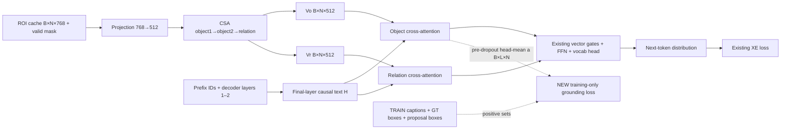

# Đề xuất giám sát từ–vùng cho CSA

04/11/2026 (UTC+7). **ĐỀ XUẤT / CHỜ NGƯỜI DÙNG DUYỆT**; chưa phải protocol đã khóa hoặc kết quả thực nghiệm. Đã đọc AGENTS, RESEARCH_STATE, X069, `model.py`, `plain_model.py` và [báo cáo TEST](PLAIN_VS_CSA10_TEST_RESULT.md) tại commit `44ed883`. Chưa viết trainer/notebook, chưa chạy mô hình, Torch/autograd, Kaggle hoặc scorer.

## 1. Khuyến nghị và giả thuyết

Ưu tiên **giám sát attention đối tượng đang được decoder sử dụng bằng nhãn từ–vùng**, kế thừa GVD và cách xử lý nhiều vùng dương của NBT. Đây là phép thử hẹp để xác định CSA có hưởng lợi từ giám sát định vị hay không. Chưa có bằng chứng rằng phương án này sẽ giảm CHAIR hoặc tạo đóng góp mới.

**Giả thuyết:** tín hiệu từ–vùng đủ sạch giúp decoder chọn bằng chứng phù hợp khi dự đoán danh từ, từ đó tăng CIDEr và giảm hallucination so với CSA tiếp tục XE cùng ngân sách, trong khi giữ recall. Nguyên nhân “CSA ảo giác vì attention sai” chưa được xác lập. Nếu chỉ định vị tốt hơn nhưng caption không đạt mục tiêu, hoặc không phụ thuộc attention được giám sát, không tiếp tục cấu hình này chỉ dựa trên attention map.

### Căn cứ trong dự án

NoCSA10 → CSA10 trên cùng TEST 5.000 ảnh: CIDEr 0,569220 → 1,019207; recall 24,0633% → 41,4327%; CHAIRs 3,92% → 6,18%; CHAIRi 4,4285% → 4,6118%. False mentions tăng 229 → 341; caption có hallucination tăng 196 → 309. CSA sửa 91 nhưng tạo 204 trường hợp, tăng ròng 113. Độ dài tăng 5,1618 → 8,1216 từ; caption ≤2 từ giảm 1.853 → 388.

Độ phủ và số nhắc sai cùng tăng. Chưa thể kết luận độ dài là nguyên nhân duy nhất hoặc bank là thủ phạm. Đây là một seed, khác capacity, cùng ngân sách 10 epoch; baseline còn cải thiện cuối lịch nên chưa phải so sánh khi hội tụ.

Hai chi tiết kiến trúc ảnh hưởng trực tiếp tới lựa chọn phương pháp:

- `SemanticAggregation` tạo 150 vector hỗn hợp học được từ bank 5.269 danh từ / 1.594 động từ. Prototype không có nhãn một-một với tên đối tượng. Các phép tương đồng và gate hiện học gián tiếp qua caption XE, chưa có nhãn word–box.
- `Vo` đã qua visual self-attention và semantic fusion; ROI đầu vào cũng được pooling từ CLIP patches có ngữ cảnh toàn ảnh. Vector tại chỉ số vùng không chỉ chứa thông tin pixel trong box đó. `Vr` dùng bank động từ, chưa phải grounding đầy đủ bộ ba subject–relation–object.

Vì vậy, bộ “kiểm chứng prototype bằng CLIP rồi gate” chưa phải ưu tiên: nhãn prototype không rõ và việc kiểm chứng có thể lặp lại phép tương đồng vốn có. Giám sát attention đang tham gia sinh caption dễ kiểm tra hơn và không tăng tham số.

## 2. Ba phương pháp đã đọc

Đây là so sánh có trọng tâm ba nguồn gốc, không phải tổng quan hệ thống hoặc xác nhận tính mới. Phạm vi đọc là các mục dưới đây, không tuyên bố đã kiểm toàn bộ bài hay chạy code tác giả. URL, hash PDF và phạm vi kiểm chứng nằm trong [hồ sơ nguồn](GROUNDED_ATTENTION_SOURCES_2026-11-04.json).

| Phương pháp / nguồn gốc | Nội dung đã đọc và có thể kế thừa | Mức phù hợp |
|---|---|---|
| Zhou et al., **Grounded Video Description — GVD**, CVPR 2019. [CVF](https://openaccess.thecvf.com/content_CVPR_2019/html/Zhou_Grounded_Video_Description_CVPR_2019_paper.html), [PDF](https://openaccess.thecvf.com/content_CVPR_2019/papers/Zhou_Grounded_Video_Description_CVPR_2019_paper.pdf) | §4.1–4.4, Eq. 1–8, §5 và Tables 2–4; xem trực tiếp trang công thức PDF 5. Giám sát region attention, region classification và grounding bằng box; có grounding-aware encoding và thử trên Flickr30k Entities. | **Ưu tiên kế thừa giám sát attention.** Table 2: attention-only tăng CIDEr 44,6 → 47,0 trên ANet validation. Table 4: full GVD đạt 62,3 so với 60,1 của “Our Unsup. (w/o SelfAttn)” trên Flickr30k test; đây là so sánh toàn cấu hình, không tách riêng attention loss. Không dùng các số này để dự báo CSA/COCO. Tác giả nói rõ ở p.6 rằng không áp dụng trên COCO vì thiếu exact word–box correspondence và chỉ có 80 lớp. Không có bằng chứng CHAIR cho cấu hình của ta. |
| Lu et al., **Neural Baby Talk — NBT**, CVPR 2018. [CVF](https://openaccess.thecvf.com/content_cvpr_2018/html/Lu_Neural_Baby_Talk_CVPR_2018_paper.html), [PDF](https://openaccess.thecvf.com/content_cvpr_2018/papers/Lu_Neural_Baby_Talk_CVPR_2018_paper.pdf) | §3.1–3.4, Eq. 4–13, visual-word extraction; xem trực tiếp trang PDF 5. Pointer chọn region hoặc sentinel, tạo slot rồi lexicalization. COCO dùng ánh xạ yếu category–word; nhiều proposal có thể cùng là positive. | Có đường region → word rõ hơn, nhưng full NBT thay decoder và chính sách sinh từ khá nhiều. Pilot chỉ kế thừa **gom xác suất của tập vùng dương**, chưa dùng pointer, sentinel hoặc lexical refinement. NBT yêu cầu IoU và nhãn detector phù hợp; đề xuất của ta bỏ điều kiện nhãn detector, dùng GT category và audit riêng. |
| Wang et al., **Efficient Image Captioning for Edge Devices — LightCap**, AAAI 2023. [DOI](https://doi.org/10.1609/aaai.v37i2.25359), [PDF bản tác giả](https://arxiv.org/pdf/2212.08985) | §3.1–3.2, Eq. 1–2; đầu §3.3 để kiểm phạm vi distillation. Concept extractor chiếu ROI vào text embedding bằng contrastive training; concept tokens điều tiết channel của visual features. | Gần hướng bank điều kiện theo ảnh đã có trong repo, nhưng thêm extractor, supervision và modulator. CLIP similarity không chứng minh presence; concept corruption có thể tạo âm giả. Điểm toàn hệ còn liên quan pretraining, distillation và ensemble. Chưa có bằng chứng giảm CHAIR trên CSA của ta. |

Lịch sử liên quan: [G/S](../noun_evidence_proposal/GS_RESULT.md) từng thất bại khi thêm noun-logit evidence trên A; [CDR-AEV](../semantic_grounding_method/ASTRA_CDR_AEV_DECISION_2026-10-30.md) đã bỏ mass-veto; [image-conditioned bank](IMAGE_CONDITIONED_BANK_CANDIDATE.md) vẫn là đề xuất. Không suy rộng thất bại trên A thành việc mọi grounding loss trên CSA đều thất bại.

## 3. Pipeline và tensor

[PNG](GROUNDED_ATTENTION_PIPELINE_2026-11-04.png) · [SVG](GROUNDED_ATTENTION_PIPELINE_2026-11-04.svg) · [PDF](GROUNDED_ATTENTION_PIPELINE_2026-11-04.pdf) · [nguồn DOT có thể sửa](GROUNDED_ATTENTION_PIPELINE_2026-11-04.dot).

**Giữ lại:** CLIP và banks đóng băng; projection 768 → 512; hai tầng object và một tầng relation; decoder 3 lớp / 8 heads; gates, vocabulary 10.000 từ và beam 5 / max length 20. Toàn bộ phần trainable cũ vẫn được cập nhật trong cả hai arm.

**Thêm:** đọc masked softmax QK **trước dropout** của object cross-attention ở lớp decoder cuối, rồi tính grounding loss. Dùng đúng Q/K của attention tham gia forward; không thêm một attention riêng. Context giữ dropout như cũ. Không thêm tham số hay module inference; không thay thành phần sinh caption.

| Tensor | Kích thước và vai trò |
|---|---|
| `R`, `region_valid` | `B×N×768`, `B×N`; ROI cache, có pad theo batch |
| `Vo`, `Vr` | `B×N×512`; hai bộ nhớ đang có |
| `H` | `B×L×512`; hidden sau causal self-attention/norm ở decoder lớp 3 |
| `Co`, `Cr` | `B×L×512`; context đối tượng / quan hệ |
| `A_pre`, `a` | `B×8×L×N`, `B×L×N`; attention trước dropout và trung bình head |
| `logits` | `B×L×10000`; next-token logits từ head cũ |
| `P` | Tập chỉ số proposal dương cho từng mention đủ nhãn; chỉ dùng trong loss |

Embedding của từ trước vẫn vào hai vector gates. Pad-region bị mask. Vị trí input `ids[:,t]` dự đoán `ids_full[:,t+1]`; positive set phải gắn với **target kế tiếp**, không gắn nhầm với từ input. Target word/box không vào query hoặc forward sinh caption.

Bật `need_weights=True` đơn thuần chưa đủ: MHA có thể trả trọng số sau dropout và đổi kernel. Khi được duyệt triển khai, cả hai arm phải dùng cùng đường tính attention; kiểm forward tương đương với λ=0 ở dropout=0 và gradient qua đúng Q/K. Chưa thực hiện các kiểm tra runtime này.

## 4. Nhãn, loss và âm giả

Ánh xạ mention trong caption TRAIN sang COCO category `c` bằng lexicon hẹp gồm lemma, plural và synonym được audit. Nhận diện compound dài nhất trước, ví dụ “hot dog”, “teddy bear”, “baseball bat”; mỗi mention có một target token đại diện được ghi trong lexicon (thường là từ cuối), tránh giám sát lặp cả span hoặc nhận “dog” trong “hot dog”. Nếu chưa xác định nghĩa hoặc token đại diện, bỏ grounding cho cả span, vẫn giữ XE.

Với proposal `r_n`, tập dương là:

$$
P_{it}=\{n:\max_{g\in GT_i(c)}IoU(r_{in},g)\ge0.5,\quad r_{in}\text{ không fallback/pad}\}.
$$

Lấy **tất cả instance cùng category**, vì caption không nhất thiết cho biết đang nói instance nào. Đây là nhãn category-level, không phải exact phrase–instance grounding. Ngưỡng ≥0,5 là lựa chọn đề nghị dựa trên tiền lệ, không tuyên bố trùng tuyệt đối ngưỡng của bài gốc.

Bỏ grounding ở mention mơ hồ, ngoài 80 lớp, thiếu GT, thiếu positive proposal hoặc có crowd annotation cùng category; vẫn giữ XE. Không dùng nhãn detector làm gold; detector-miss không có nghĩa đối tượng vắng mặt. Coordinate convention, thứ tự box–feature và lexicon phải được khóa từ TRAIN.

Với `a_itn` là trung bình 8 heads của masked pre-dropout softmax:

$$
L_{XE}=-\frac1{|T|}\sum_{(i,t)\in T}\log p_\theta(y_{it}\mid y_{i,<t},R_i),
$$
$$
L_{ground}=-\frac1{|E|}\sum_{(i,t)\in E}\log\left(\sum_{n\in P_{it}}a_{itn}\right),
\qquad L=L_{XE}+\lambda L_{ground}.
$$

`T` bỏ PAD; `E` gồm các mention đủ điều kiện. Khi `E` rỗng, grounding loss bằng 0. Khi triển khai, cần log-sum-exp ổn định và chuẩn hóa theo tổng eligible mentions trên cả hai rank, có xét phép trung bình gradient của DDP. Không lấy trung bình loss của hai rank có số nhãn khác nhau rồi coi đó là trung bình toàn batch.

**λ=0,1 chỉ là mức khởi đầu đề nghị**, chưa được duyệt hoặc tối ưu; pilot dùng một mức, chưa sweep.

Phân biệt nguồn: GVD Eq. 3 dùng `−Σγ log α`, khác công thức trên. NBT Eq. 13 có `−log((1/m)Σpositive p(region))`; với positive set cố định, khác mass loss bằng hằng `log m` đối với gradient của region distribution. Chọn marginal mass để không buộc phân phối đều lên mọi instance cùng lớp khi caption có thể chỉ nói một instance. Đây là điều chỉnh có tiền lệ, không phải loss mới.

**Không dùng negative sampling danh từ hoặc nhãn vắng mặt từ detector/annotation.** Tuy nhiên, softmax mass loss vẫn làm các vùng ngoài `P` cạnh tranh với `P`: chưa thể nói unknown đã hoàn toàn bị loại khỏi loss. Thiếu annotation, proposal lệch box hoặc IoU thấp có thể tạo âm giả ngầm. Giảm rủi ro bằng all-instance positives, bỏ trường hợp mơ hồ/crowd, audit ảnh và báo coverage/skip theo lớp. Nếu support thật thường nằm ngoài `P`, dừng trước GPU; không có bảo đảm triệt tiêu âm giả.

Đã cân nhắc chuẩn hóa chỉ trên `P ∪ known-negative` để bỏ unknown: tỷ lệ này có thể gần 1 dù phần lớn attention nằm ở unknown, nên chưa chọn cho phép thử đầu. Chưa thêm loss absence để bù vấn đề nhãn.

## 5. Dữ liệu khi huấn luyện và inference

| Giai đoạn | Dữ liệu cần dùng |
|---|---|
| TRAIN | Tập train + restval gồm 113.287 ảnh; captions, vocabulary và ROI cache cũ; proposal boxes theo đúng thứ tự; COCO instance annotations của image ID thuộc TRAIN; lexicon khóa từ TRAIN. `val2014` có thể chứa restval thuộc Karpathy TRAIN: lọc bằng image ID của split, không bằng tên file annotation. |
| VALID | 5.000 ID riêng. Reference caption và GT box dùng tính metric / diagnostic; không đưa vào beam generation. Khóa cohort trước khi xem dự đoán mới. |
| Inference | Ảnh mới → detector/CLIP ROI theo pipeline cũ → CSA với prefix tự sinh; bank toàn cục như baseline. Không có reference caption, GT box/category, positive mask hoặc grounding loss. |
| TEST | Không chọn λ, lexicon hoặc checkpoint theo TEST. Không chạy lại hai baseline. Sau khi khóa phương pháp mới đề nghị lượt đánh giá tiếp; tập TEST đã được xem nên không gọi đó là holdout hoàn toàn chưa chạm tới. |

Trong code, `prepare_real_assets.pack_regions` giữ `boxes`, `offsets`, `ids`; `prepare_full_regions` có metadata `region_kinds`/fallback. Nhưng `full_cache_data.stage_full` hiện chỉ stage features/IDs/sequences, không giữ boxes/kinds. Cần metadata sidecar sau khi được duyệt để nối đúng hàng. Dự kiến tận dụng cache, không chạy lại CLIP/detector; điều này còn phụ thuộc audit artifact thực tế. Chưa mở actual NPZ hoặc instance annotation để khẳng định coverage hay mount sẵn.

## 6. Phép thử nhỏ nhất để tiếp tục hoặc dừng

**Bước 0 — audit dữ liệu trước GPU.** Chọn cố định 10.000 TRAIN image IDs, đếm coverage ánh xạ, vị trí danh từ, kích thước tập dương, IoU coverage và các lý do skip theo lớp. Kiểm coordinate convention, row offsets, fallback và compound. Xem thủ công 100 mention–region cases phân tầng theo lớp, kích thước và nhiều instance; không chọn theo lỗi TEST.

Cổng đề nghị: ít nhất 95/100 cases có mapping/positive set hợp lý; ít nhất 80% mentions đã map và có noncrowd GT tìm được positive proposal. Báo lớp ít mẫu và coverage trên toàn bộ mentions, không chỉ mẫu đã qua lọc. Các ngưỡng là cổng vận hành đề nghị, chưa chứng minh độ sạch 95% trên toàn dữ liệu. Fail thì sửa nhãn/audit hoặc bỏ hướng, chưa viết notebook train.

**Bước 1 — đúng hai arm cùng điều kiện.** Cả hai bắt đầu từ CSA epoch 10 đã khóa trong yêu cầu, không chọn checkpoint lại theo TEST:

| Điều kiện | A: đối chứng | B: đề xuất |
|---|---|---|
| Loss | XE | XE + 0,1 × grounding |
| Dữ liệu / thứ tự | Cùng TRAIN 10k và caption-event order | Như A |
| Ngân sách | 2.000 updates, global batch 32 | Như A |
| Khởi tạo / optimizer | Cùng checkpoint và RNG; đề nghị fresh Adam, LR 1e-5 | Như A |
| Attention instrumentation | Cùng đường tính pre-dropout attention | Như A |
| Cập nhật trọng số | Các phần trainable CSA; CLIP/banks frozen | Như A |

Mỗi arm có 64.000 caption events. Fresh Adam/LR 1e-5 là thiết kế mới để thử thích nghi hẹp, chưa khóa và không gán cho recipe baseline cũ. So endpoint cố định, chưa chọn checkpoint từ nhiều lần VALID. Snapshot gốc chỉ là mốc phụ; đối chứng quyết định là XE continuation cùng ngân sách.

Đánh giá full VALID 5.000 ảnh, beam 5 / max length 20 / scorer cũ. Báo CIDEr, CHAIRs/i, recall, false-caption/false-mention counts, object mentions, số class–image pairs đúng, độ dài và tỷ lệ caption ≤2 từ. Bootstrap paired theo image ID; CHAIRi phải tính lại tổng tử/mẫu ở mỗi resample. Báo repairs/new hallucinations và cohort có/không có nhãn grounding. Phân tích độ dài là mô tả, không dùng TEST để điều chỉnh độ dài cứu kết quả.

**Cổng tiếp tục đề nghị, so B − A trên VALID:**

- CIDEr tăng ít nhất 0,01 raw, tương đương 1 điểm trên thang ×100.
- CHAIRs giảm ít nhất 0,3 điểm phần trăm; CHAIRi không tăng.
- Recall không giảm quá 0,5 điểm phần trăm; tỷ lệ caption ≤2 từ không tăng quá 1 điểm phần trăm.
- Kiểm số object mentions, nội dung và số nhắc sai: giảm CHAIR bằng caption chung chung / bỏ đối tượng không đạt mục tiêu.

Báo khoảng tin cậy; điểm ước lượng đạt cổng nhưng CI chưa phân biệt được 0 chỉ là tín hiệu đáng thử tiếp, chưa phải gain đã được xác nhận. Hai arm / một seed chỉ sàng lọc. Fail không chứng minh mọi dạng grounding đều vô ích, nhưng không đủ lý do mở rộng cấu hình này. Ngưỡng, λ và endpoint cần được duyệt trước run.

**Bước 2 — kiểm sự phụ thuộc vào bằng chứng, có điều kiện.** Nếu bước 1 có tín hiệu chất lượng, dùng 200 eligible VALID mentions cố định, cùng teacher-forced prefix cho A/B. Can thiệp attention/context ở lớp cuối: chặn support `P`, so với chặn tập vùng control không-target có số vùng, attention mass và kích thước box tương đương; đo thay đổi log-probability của target word. Báo/skip trường hợp không có control phù hợp. Thêm forward với attention uniform/permuted để kiểm nhánh có bị decoder bỏ qua không.

GT chỉ dùng cho phép đo này, không dùng để sửa caption sinh tự do. Vì CLIP ROI và `Vo` đã chứa ngữ cảnh toàn ảnh, và `Vr` có thể cung cấp đường thông tin khác, đây chưa phải bằng chứng nhân quả ở mức pixel. Can thiệp cũng có thể gây dịch chuyển phân phối hidden state.

**Phép bác bỏ:** attention mass/IoU accuracy tốt hơn nhưng quality gate không đạt, hoặc chặn vùng đúng không ảnh hưởng hơn control và uniform/permuted attention gần như không ảnh hưởng danh từ. Khi đó dừng cấu hình, không tự cộng gate/loss. Nếu có cả chất lượng và sự phụ thuộc, mới đề nghị control huấn luyện với correspondence bị hoán vị, giữ eligible positions và positive-set cardinalities, để phân biệt lợi ích của nhãn đúng với regularization. Thắng nhãn sai chưa đủ: vẫn phải thắng XE. Đây là bước cần trước kết luận về cơ chế, chưa phải arm GPU đã được duyệt.

T4 ×2 đã chạy được CSA, nhưng lấy attention weights có thể đổi memory/latency; chưa đo overhead hoặc ước tính giờ chạy. **Cần cập nhật ngân sách GPU khi duyệt pilot, trước khi chốt lượt chạy lớn.** Không dùng quota cũ, không tự mở thêm nhánh hoặc chạy Kaggle.

## 7. Kế thừa, điều chỉnh và giới hạn đóng góp

- **Kế thừa:** CSA backbone; GVD giám sát region attention; NBT weak category–word matching và marginalization trên nhiều vùng dương; XE và IoU-based positives.
- **Điều chỉnh cho dự án:** loss trên object attention của lớp Transformer cuối, trung bình 8 heads trước dropout, category-level masks từ COCO và cached CLIP ROI; giữ nhánh động từ; đối chứng continuation và phép kiểm sự phụ thuộc.
- **Chưa đủ cơ sở gọi mới:** chưa có operator/loss mới, chưa tái lập full GVD/NBT, chưa chứng minh exact instance grounding, S–R–O grounding hoặc giảm hallucination. Kết quả tốt có thể làm nền cho bài ứng dụng/thích nghi có đối chứng; muốn khẳng định phương pháp mới phải xác định thay đổi kỹ thuật và đối chiếu prior riêng.

Có một lượt phản biện kỹ thuật bằng agent độc lập cùng họ model, tập trung vào nguồn GVD/NBT, vị trí pre-dropout/next-token và giới hạn ngữ cảnh toàn ảnh. Đây không phải review của con người hoặc kiểm chứng bằng họ model khác. Skill áp dụng: `academic-research-suite`, dùng cho đọc nguồn và tổng hợp có trọng tâm; không gửi dữ liệu sang dịch vụ review bên ngoài.
