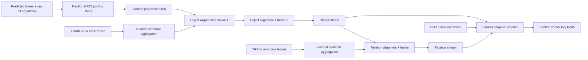

# CSA theo paper: core tự viết

Đây là baseline theo cơ chế CSA với đặc trưng CLIP/detector thay thế. Không dùng code tác giả, Q-Former hoặc decoder/checkpoint C0; không phải phương pháp mới hay cam kết đạt số liệu paper. Xem [protocol](IMPLEMENTATION_PROTOCOL.md) và đặc tả X024.

`model.py`: aggregation, cosine selection, 2 OSA + 1 ORA, dual-stream decoder, XE, beam5 và beam-mean loss. `data.py`: fractional pooling, vocab TRAIN-only, EOS và POS-list contracts. Căn chỉnh nằm ở cosine semantic-prototype ↔ region selection và cross-attention/fusion trong ba blocks; không gán từng từ caption thành nhãn box.

## Lượt chạy đầu tiên

Tải `CSA_PAPER_CORE_SMOKE.ipynb` lên Kaggle, bật Internet + GPU. Không cần dataset/checkpoint/token. Chỉ dùng GPU0. Notebook khóa commit/hash nguồn, giữ log và xuất review ZIP kể cả runtime lỗi. Không pip đổi các thư viện môi trường ở lượt này.

**Dữ liệu/banks/rewards trong smoke đều giả.** Kiểm được forward/gradient chưa chứng minh model caption tốt, inputs thực hợp lệ, hoặc DDP2GPU đúng. Hai cập nhật XE và một RL chỉ là regression smoke, không là epoch hay kết quả nghiên cứu. Không lưu checkpoint ngẫu nhiên này để làm baseline.

## Bằng chứng đã có và bước kế tiếp

- Local: đã kiểm JSON Karpathy, 113287 TRAIN (82783 train +30504 restval),5000 val,5000 test; file H5 tồn tại/kích thước. Metadata H5 đến từ báo cáo user trước đó, chưa mở lại bằng h5py trong lượt này. `LOCAL_ASSET_INVENTORY.json` giữ nguồn và giới hạn; chưa đọc tensor.
- Local NumPy/static: 6 tests PASS; chưa Torch/gradient/GPU/model/scorer/notebook execution.
- User-run core smoke đã COMPLETE; xem [kết quả](CORE_SMOKE_RESULT.md). Sau đó chuẩn bị bank TRAIN thật bằng POS + CLIP frozen, vocab và join detector/patches/dimensions; chưa có cache CSA mới hay real-data training notebook ở mốc core này.
- Quota hiện báo20giờ. Chưa ước lượng full recipe trước throughput/VRAM thực; không mở15XE+30RL.

## Kiểm dữ liệu thật trên CPU

Sau core smoke COMPLETE, chạy `CSA_PAPER_ASSET_INVENTORY_CPU.ipynb`, Accelerator **None**, Internet ON, Add Input `visual-cache`, `objectdetectionecache`, `mscoco-2014`. Cell đầu có bốn path để chỉnh nếu mount khác. Không cần checkpoint/prompt/UPT/token. Xuất `csa_paper_asset_inventory_review.zip`. Chưa POS/textbank/ROI/training; không dùng GPU. Local3parser/static+6data testsPASS, actual mounted HDF5/detector/RGB traversal chưa chạy.

CPU inventory user-run COMPLETE: xem [kết quả dữ liệu thật](ASSET_INVENTORY_RESULT.md). Không cần chạy lại. H5metadata/ID tables và detector phủ123287ảnh; vocabulary10000 đã tái tạo khớp. Banknoun/verb và ROIcache thực vẫn chưa tạo; bước tiếp thực hiện chúng trước real-data smoke.

## Chuẩn bị noun/verb và ROI thật

Chạy `CSA_PAPER_REAL_PREPARATION_CPU.ipynb` trên **CPU/Accelerator None**, InternetON, cùng3datasetđãdùng. Nó chạy POSspaCy trên toànTRAIN để tạo **danh sách từ** cho bank và poolROI cho256TRAIN+64val. Chưa mã hóaCLIPtext hay huấn luyện captioner. Gửi `csa_paper_real_preparation_review.zip`; giữ **cả folder `csa_paper_real_preparation`, đặc biệt `regions.npz`**, để lưuDatasetcho bướcGPUtiếp. Xem [protocol](REAL_ASSET_PREPARATION_PROTOCOL.md).14localtestsPASS, thực thiPOS/ROI và cài dependency trênKagglechưađượckiểm.
