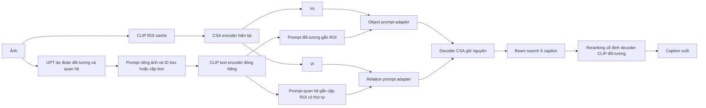

# Tích hợp prompt đối tượng và quan hệ gắn vùng vào CSA

Ngày 05/11/2026. **R249 — phương án đề xuất để người dùng duyệt, chưa triển khai hoặc chạy.** Mục tiêu: hoàn thiện nhánh prompt của đề cương và thử tăng CIDEr/giảm ảo giác so với CSA hiện có. Đây là cách kế thừa CSA, CLIP và UPT, không có khẳng định mới hay hiệu quả đã được chứng minh. Giữ nguyên kết quả TEST117.0633 của pipeline không có prompt UPT.

## 1. Quyết định kiến trúc được đề xuất

Giữ nguyên backbone, hai bộ nhớ Vo/Vr, bank ngữ nghĩa và decoder CSA đang có. Thêm **hai residual adapter gắn prompt với vùng ảnh**, ngay sau `encode()` tạo Vo/Vr và trước `decode()`. Object adapter cập nhật Vo; relation adapter cập nhật Vr. Không thêm một memory thứ ba vào decoder, không thay bank chung bằng một đoạn văn không có liên kết box.

Nguồn prompt là dự đoán trên **chính ảnh đang chú thích**, không phải caption truy hồi từ ảnh khác. Đây là ranh giới với hướng Fact RAG của Tâm. CLIP mã hóa ngữ nghĩa prompt, không tự xác nhận nội dung của UPT là đúng.

## 2. Dùng lại dữ liệu đã có, không tự tạo quan hệ mới

Nguồn lịch sử do người dùng cung cấp: `/kaggle/input/datasets/ducanh2403/upt-prompts-full-all-actions-v2/prompt_cache.json`. Kiểm tra hash/schema/coverage thực tế trước dùng; mốc kiểm cũ `24e7861a4aa0e7e731d67689dce195688096232bcbef1b4264034cf520d6957d` đã kiểm11000entries ở pilot trước, không tự chứng minh mount hiện tại giống hệt.

Dùng `objects` và `relations` có cấu trúc, không parse ngược chuỗi `prompt` tổng hợp. Code cũ đã giữ object index/instanceID/box/confidence và subject/object instance/predicate/score/threshold/text. `candidate_preview` không được coi là quan hệ đã qua lọc. Giữ chính sách nhận quan hệ đã chốt của cache; không áp0.5 chung cho tất cả predicates hay tự chuyển `riding` thành `surfing` chỉ vì object là surfboard. UPT hiện tại có actor là person; không gọi đây là detector cho mọi quan hệ giữa hai đối tượng bất kỳ.

- Mỗi object instance giữ một prompt như `a person`, `a horse`, kèm box và instanceID. Hai con ngựa có thể dùng chung embedding text nhưng vẫn là hai record/box khác nhau.
- Mỗi relation giữ **toàn bộ bộ ba có hướng**, ví dụ `a person riding a horse`, kèm subjectID/objectID và cả hai box. Không rút xuống chỉ động từ `riding` hoặc loại trùng hai cặp chỉ vì cùng câu chữ.
- Trần đề xuất cho pilot:8object instances/3relations mỗi ảnh. Ưu tiên giữ endpoints của quan hệ được cache chọn, rồi bổ sung objects theo confidence/thứ tự cố định. Đây là cap mới cho tensor object instances, không nhầm với cap8tên đối tượng trong câu cũ; thống kê số record bị cắt trước khi khóa.
- Prompt không cần thêm `a photo showing`; dùng cụm tự nhiên theo template hiện có. Trường hợp grammar đặc biệt/role không xác định giữ template cũ, không tạo bộ ba có nghĩa khác.

Frozen CLIP text encoder cùng model/revision của semantic banks hiện tại: `openai/clip-vit-base-patch16`, revision `57c216476eefef5ab752ec549e440a49ae4ae5f3`, embedding512chiều. Chuẩn hóa L2 và cache theo exacttext+templateversion+model/tokenizer/processor identities. Kiểm độ dài trước giới hạn tokenizer, không âm thầm cắt. Việc mã hóa CLIP thực tế do người dùng chạy; chưa có cache mới hoặc thời gian đo được. Không ghép vector của các model khác không gian rồi tính cosine trực tiếp.

## 3. Liên kết UPT với ROI hiện có

Hai detector không có cùng chỉ số instance. FullROI134 đã lưu features768chiều và boxes; cần join bằng COCO ID/filename và box tọa độ chuẩn hóa, không dùng index UPT làm index ROI. Dùng nhãn COCO tương thích từ detector metadata gốc và IoU, ngưỡng đề xuất0.5, hòa chọn index sớm hơn; chỉ nhận liên kết endpoint không mơ hồ. Báo tỷ lệ mapping và phân bố IoU theo split/mode, số tiny/crowd/overlap, không chỉ báo số prompt có text.

Chỉ dùng ROI đối tượng thật để map, không coi full-frame fallback là box horse/person. Relation hợp lệ để inject chỉ khi cả S/O map được tới hai ROI khác nhau. Không map được thì bỏ **slot chưa gắn vùng**, không lấy nhầm box hoặc sửa predicate. Quan hệ không map được vẫn được thống kê như coverage loss, không đổi sang nhãn sai. Nếu mapping mất quá nhiều endpoint, dừng chuẩn bị để bàn việc pool UPT boxes từ CLIP patch cache gốc; không tự chạy model hoặc hạ ngưỡng để có đủ dữ liệu.

Không yêu cầu giải nén lại dataset hay chạy lại UPT nếu cache đủ. Metadata join có thể chuẩn bị CPU; pooling cache gốc chỉ là phương án cần duyệt khi có bằng chứng mapping không đủ. Coverage hiện tại của phép join này **chưa được đo**.

## 4. Cơ chế căn chỉnh và hợp nhất cụ thể

Vo,Vr có shape N×512. Gọi e_o,j và e_r,k là CLIP embeddings512chiều, pi(j) là ROI của objectj đã map. Tạo token đã gắn vùng:

`z_o,j = MLP_o([e_o,j ; Vo[pi(j)] ; bbox_j])`.

`z_r,k = MLP_r([e_r,k ; Vo[pi(subject_k)] ; Vo[pi(object_k)] ; geometry(subject_k, object_k)])`.

Hai MLP đưa về512chiều; geometry8chiều dùng quy ước đã có trong `experiments/upt_alignment_pilot/pilot_data.py:geometry`. Giữ thứ tự S/O trong phép nối và metadata, không dùng tổng đối xứng. Geometry là bối cảnh không gian, không phải phép suy ra nhãn hành động. Chưa có union-crop feature riêng trong bản tối thiểu này; các tương tác ngoài endpoint ROI vẫn là một hạn chế.

Hai cross-attention có mask hình học:

`D_o = MHA_o(Q=Vo, K=Z_o, V=Z_o; mask_o)`

`D_r = MHA_r(Q=Vr, K=Z_r, V=Z_r; mask_r)`

`Vo_new = Vo + W_o D_o`, `Vr_new = Vr + W_r D_r`.

Object slot chỉ hỗ trợ ROI mà nó map tới; relation slot hỗ trợ hai endpoint ROI của đúng cặp đó. Row không có prompt hợp lệ cho residual0, không softmax toàn−inf hoặc tạo null prompt thành bằng chứng. Phần visual/baseCSA vẫn đọc toàn ảnh theo kiến trúc gốc. Z chứa cả ngữ nghĩa prompt và đặc trưng vùng riêng ảnh; attention/gate không được diễn giải như xác suất đúng quan hệ. Đây là **căn chỉnh ở mức cụm và vùng/cặp vùng**, không tuyên bố đã định vị từng từ hoặc phân biệt mọi instance hoàn hảo.

Khởi tạo output projection W_o,W_r bằng0, giữ đường residual ngoài mọi LayerNorm mới để tắt adapter hoặc không có prompt trả về đúng Vo,Vr cũ. Không thêm LayerNorm/scale toàn bộ memory làm đổi checkpoint ở update0. Upstream adapter có thể chưa nhận gradient ở bước đầu khi output projection bằng0; kiểm gradient theo giai đoạn sau vài bước, không báo đứt graph chỉ vì bước0. Base decoder signature vẫn nhận hai memory, giữ vocab/tokenizer/beam5/max20.

Đường prompt đi trực tiếp vào memory mà decoder sử dụng. Tuy vậy decoder vẫn có thể bỏ qua nó; thiết kế này không tự khắc phục thất bại conditioning cũ.

## 5. Học như thế nào

Đề xuất khởi tạo cả đối chứng và mô hình có prompt từ **checkpoint SCST+CE161 đã có**, SHA `58ce5dc0e30ac26add9bac8e24a2e9e03b91532bfdeece588997395bf9cfc16b`. Không huấn luyện lại từ đầu ngay và không thay bản checkpoint đã báo cáo. Frozen CLIP/UPT/cache; train captionerCSA cùng adapter mới, đối chứng train cùng captioner không adapter. Fresh optimizer và cùng seed/thứ tự ảnh/budget/VALID checkpoints; không so riêng với con số cũ để quy lợi ích cho prompt.

Giữ loss đã có hiệu quả: `L = L_CE + 0.05 L_SCST(CIDEr-D)`, không thêm object reward hoặc contrastive pseudo-relation loss trong bản đầu. CE dùng caption TRAIN; SCST dùng sampled/greedy với reward TRAIN-only, sameIDF/scaling/dropout/gradclip như bản161. Prompt lấy từ inference UPT của ảnh TRAIN, **không lấy từ caption tham chiếu hoặc GT triples**. Caption tham chiếu chỉ đi vào CE/reward/evaluation. Căn chỉnh được xây bằng liên kết box/cặpbox và attention, học công dụng thông qua caption loss; chưa có giám sát grounding thật riêng.

Pilot đề xuất500updates/global8 tức4000imageevents, không gọi là một full epoch TRAIN. Chọn cohort/thứ tự cố định trước model run, giữ đủ cả object_relation/object_only/no_objects theo phân bố thực tế. Con số pilot là đề xuất, chưa duyệt; quota/số tài khoản/cap/optimizerLR chi tiết phải cập nhật trước viết notebook. Không dùng số giờ GPU lịch sử như quota hiện tại. Không tự mở một chuỗi warmup/ablation/fulltrain dài.

## 6. Kiểm tra nhỏ nhất trước mở rộng

1. Metadata: đủ schema/sourcehash/IDs và split; không trộn UPT index với ROI index; reportmapping/truncation/template/emptycases; không ref/GT trong inferencepayload. API/model không chạy trong audit này.
2. User-run model smoke: closed-adapter và no-prompt parity, finite logits/gradients, variableprompt/padding/emptyattention rows; matched DDP unequalgroups; object/relation projections nhận gradient sau vài bước. Không ép tensor phải bitwiseequal giữa batchsizes nếu kernels có sai số float; tiêu chí phải đo và khóa rõ trước training.
3. Hai arm cùng500updates, fullVALID5000, báo **trước và sau cùng fixedrerank** `.3decoder/.4CLIP/.3object`; refs chỉ để chấm, không chọn prompt/beam. Báo CIDEr/B4/ROUGE/CHAIRs/i/recall/length và số đếm falsecaptions, cả điểm đầu lẫn cuối. Thiết kế kiểm wholepromptpackage, chưa tách tác động tham số và visualpairfeatures.
4. Trên cùng checkpoint có prompt: bỏ text nhưng giữ ROI/pair, hoán đổi prompt text nhưng giữ slot/box cố định, và tắt residual adapter. Đây là sensitivity probes, không coi prompt tráo là nhãn quan hệ sai đã xác minh. Nếu không có khác biệt decoded captions, xem thêm logits/NLL nhưng không kết luận chỉ từ gradient/attention. Muốn claim lợi ích riêng từ prompt text, sau khi có tín hiệu cần đối chứng train image-onlyadapter hoặc tương đương; masked evaluation không thay thế đối chứng đó.
5. Dùng subset đã review nếu join được ID để kiểm noun/predicate/cặp đúng; không dùng CHAIR thay đánh giá quan hệ. Nếu sensitivity gần0 và quality không hơn đối chứng, dừng mở rộng để chẩn đoán, không tự tăng epoch/lambda. Đặt ngưỡng practical gain/CI/cap ở protocol chạy sau khi user duyệt, không chọn sau xem kết quả.

Không tuning lại TEST166; chỉ mở TEST cho cấu hình mới sau khóa bằng VALID và sự chấp thuận của người dùng. Ghi rõ lịch sử dự án đã tiếp xúc TEST. Giữ metric cùng tập/referenceIDF khi so sánh; không so VALID1000 của pilot QFormer cũ với TEST5000 hiện tại.

## 7. Vì sao không chỉ lặp thí nghiệm cũ

- Pilot A/B/C/D trên QFormer cũ: không hơn matched A; D textswap đổi0/1000greedycaptions. E contrastivepseudoalignment cũng không hơn A, textswap chỉ8/1000; trainingmargin tốt không chứng minh dùng quan hệ khi sinh. Nguồn: `../upt_alignment_pilot/ABCD_RESULT.md`, `../semantic_evidence_pilot/AE_RESULT.md`.
- Decoder-grounding30k trên CSA chỉ có +.428CIDErpoints/5fewerflags, CI gồm0. Không lấy nó làm bằng chứng thêm loss sẽ giải quyết conditioning.
- Đề xuất này giữ hostCSA, đưa object/relationprompt vào **hai memory hiện có** với ID/vùng rõ và kiểm sử dụng text, không quảng bá rằng đổi host/vị trí là bảo đảm hiệu quả hoặc novelty. Bằng chứng trước khiến ta cần pilot có đối chứng, không phủ nhận mọi kiến trúc prompt đều thất bại.

Kế thừa nguyên tắc căn chỉnh vùng–ngôn ngữ từ CSA và grounded captioning, không copy mã tác giả. Nguồn tham khảo: [CSA-Net tác giả](https://github.com/CrossmodalGroup/CSA-Net), [Neural Baby Talk, CVPR2018](https://openaccess.thecvf.com/content_cvpr_2018/html/Lu_Neural_Baby_Talk_CVPR_2018_paper.html). Không tuyên bố cách ghép này mới hoặc chắc tăng CIDEr.

## 8. Trạng thái và bước tiếp theo

Người dùng yêu cầu lên phương pháp, chưa phê duyệt kiến trúc/pilot/GPU. Đã đối chiếu model.py, UPT record builder, ROI schema, losses/training161 và kết quả conditioning cũ; chỉ đọc source/metadata. Chưa viết trainer/notebook, chưa chạy cache/model/Torch/scorer. Bước tiếp theo sau duyệt là kiểm kê metadata/schema và mapping vùng trước, rồi khóa protocol pilot; không chạy full ngay. Kết quả117.06 vẫn thuộc pipeline cũ không có nhánh prompt này.
