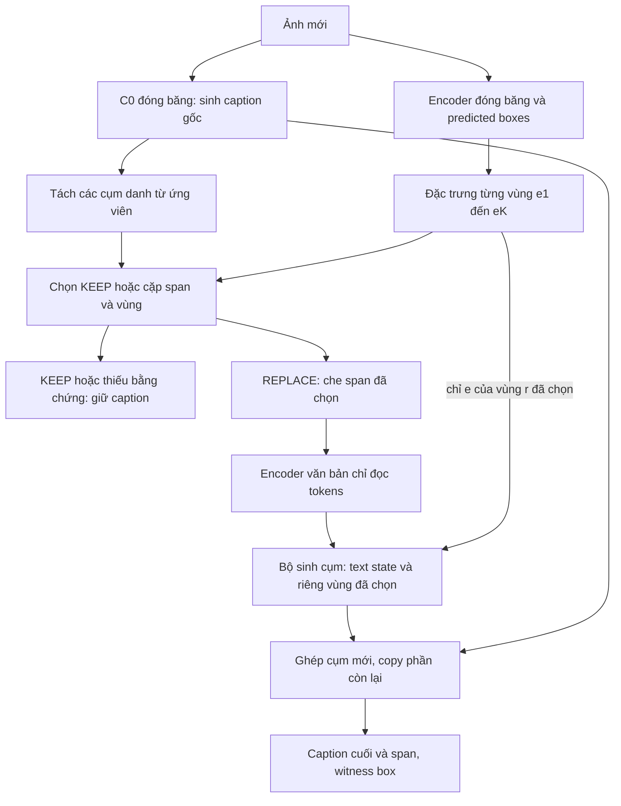

# Pipeline dự thảo: căn chỉnh vùng–cụm khi sửa caption

31/10/2026. User yêu cầu cụ thể hóa pipeline và tìm prior. Đây là **thiết kế phương pháp**, chưa phải model/code chạy được, chưa chốt protocol GPU. Đọc cùng [review trước](GROUNDED_EDITOR_NOVELTY_REVIEW_2026-10-31.md). Tên mô tả không phải tên phương pháp mới đã clearance.

## 1. Bài toán và phạm vi

Đầu vào: ảnh I và caption c do C0 hiện có sinh. Đầu ra: caption c' giữ nguyên hoặc sửa **một cụm danh từ chỉ một đối tượng**, kèm span và predicted witness box. Mục tiêu cuối vẫn CIDEr và hallucination trên toàn cohort; correctness của từng replacement là phép đo cơ chế.

Không giải quyết riding/holding, quan hệ, plural/group hoặc nested entity trong bản đầu. Vùng của một object không tự đủ chứng minh quan hệ với object khác. Không mô tả scope này thành giải pháp mọi hallucination. Từ “A” ở brainstorm posterior trước khác checkpoint baseline A; ở đây captioner dùng C0 đã lưu, không đổi tên baseline.

Phiên bản nhỏ này chỉ KEEP/REPLACE; không DELETE/INSERT tự do. Đây là giới hạn kỹ thuật để phân biệt sửa đúng với giảm nội dung, không là novelty và không bảo đảm caption không ngắn đi. ABSTAIN là lý do giữ draft khi thiếu nhãn/bằng chứng, không phải xác nhận draft đúng.

## 2. Đường tính khi dùng ảnh mới



**Căn chỉnh ở đâu:** Q học liên kết span với region-ID; G dùng chính feature của region-ID đó để tính xác suất mỗi từ của replacement. Box không được gắn sau khi một rewriter toàn ảnh đã sinh xong. Liên kết này là ràng buộc đường dữ liệu, chưa là chứng minh ngữ nghĩa đúng.

Ví dụ minh họa, không phải output thực nghiệm: draft `a man holding a tennis racket`; nếu ảnh xác minh người cầm ô, selector chọn span `a tennis racket` và vùng ô; generator sinh `an umbrella`; renderer giữ `a man holding`. Tuy nhiên bản noun-only không sửa được lỗi `holding` nếu quan hệ đó cũng sai; phải đánh giá câu cuối, không chỉ class của cụm mới.

## 3. Giao diện từng module

| Module | Đầu vào → đầu ra | Học/đóng băng |
|---|---|---|
| Draft captioner | I → caption c | C0 đóng băng ở pilot để không trộn tác động editor với fine-tune captioner |
| Proposal/visual bank | I → predicted b_r và visual e_r | Detector/CLIP đóng băng; cache chỉ tái sử dụng khi schema, preprocessing, image coverage đã kiểm |
| Span candidates | c → các khoảng tokens [l,u) không chồng lấn | POS/chunker cố định; noun phrase đơn. Danh từ ngoài scope vẫn giữ và vẫn được chấm endpoint |
| Text encoder | tokens của c hoặc c có MASK → h_text | Encoder mới chỉ đọc text; có thể dùng native embeddings. Không đưa C0 visual hidden/cache vào đây |
| Joint selector | h_span, masked context, bank → q(KEEP) và q(REPLACE,s,r) | MLP/pointer nhỏ có normalization trên tập hành động hợp lệ |
| Local phrase generator | masked context, e_r, các token replacement trước → token distribution | Một head dùng chung mọi region; chỉ nhận feature của vùng được chọn |
| Renderer | c, [l,u), replacement → c' | Copy xác định, không LLM viết lại toàn câu |

Tất cả kích thước/head/tokenizer phải chốt sau khi kiểm source, chưa giả định cache hiện có chứa đúng e_r. Native vocab hiện tại là word-level; không gọi là BPE hoặc tự resize vocabulary. Chính sách UNK/OOV cần định nghĩa trước; không đổi từ đích để tăng coverage.

Cụm gồm determiner được đưa trọn vào window để sửa `a/an`; dùng EOS riêng của decoder thay thế, không sinh phần còn lại của caption. Hạn độ dài/lỗi decode dẫn tới giữ draft và ghi ABSTAIN; coverage phải báo. Không dùng gold spans/boxes khi inference.

## 4. Phân phối và hàm loss

Với tập spans S(c) và K predicted regions, action space:

```text
Omega = {KEEP} union {(REPLACE,s,r): s in S(c), r in [1..K]}
q_theta(o | c, E) = softmax_o score_theta(o,c,E)

p_phi(y | mask(c,s),e_r)
  = product_t p_phi(y_t | y_<t, TextEncoder(mask(c,s)),e_r)
```

G không có cross-attention sang toàn bank hoặc residual global-visual; vẫn có image information gián tiếp trong draft và context/receptive field của ROI features. Không gọi đây là causal isolation. q được nhìn toàn bank để chọn; e_r thay đổi phải thực sự đi tới token logits, không chỉ tới một grounding head.

Một nhãn sửa đầy đủ gồm gold span s*, gold replacement y* và tập positive proposals R+ trỏ **cùng một instance**. Nhiều positive proposals do overlap không tương đương nhiều người trong một group.

```text
L_select(edit) = -log sum_{r in R+} q_theta(REPLACE,s*,r | c,E)
L_select(clean) = -log q_theta(KEEP | c,E)

w_r = q_theta(REPLACE,s*,r | c,E)
      / sum_{j in R+} q_theta(REPLACE,s*,j | c,E)

L_replace(edit) = -log sum_{r in R+} w_r
                 * p_phi(y* | mask(c,s*), e_r)

L = mean_{known action labels} L_select
    + lambda * mean_{fully witnessed edits} L_replace
```

Cách viết ở trên là supervised conditional objective, **không** full latent marginalization cho mọi span/unknown; không gắn tên ELBO. lambda chưa chốt. Có thể stage selector và generator riêng rồi joint; không nói hard argmax có gradient. Full-data mean cần masks và denominator rõ khi batch không có edit.

Clean = caption đã xác minh phù hợp scope; không phải caption có noun nằm trong detector labels. Nếu cần sửa nhưng proposal miss/không có witness, không gán KEEP như nhãn đúng; ghi missing witness, bỏ loss đòi witness, giữ ở đánh giá coverage. Nếu parser không tạo gold span, báo span-recall failure, không sửa gold để vừa parser.

Tạm chưa thêm SCST: objective đang học hành động và vùng–cụm có nhãn; C0 đã có SCST. Fine-tune SCST riêng sau này là quyết định khác; không cho thêm reward để che việc generator chưa dùng đúng vùng. Các loss trên đều kế thừa CE/multi-positive likelihood, không claim là loss mới.

## 5. Inference và dữ liệu tối thiểu

```text
c = C0(image)
S = eligible_noun_spans(c)
E = visual_features(predicted_boxes(image))
if no spans or no regions: return c, ABSTAIN
o = argmax q(KEEP or REPLACE,s,r | c,E)
if KEEP or selector insufficient under fixed calibration rule: return c
y = local_decode(mask(c,s), E[r])
if invalid/out-of-scope/unchanged replacement: return c, with reason
return c[:s.left] + y + c[s.right:], with span and predicted box
```

Threshold/calibration rule và limits chỉ chọn trên calibration TRAIN-derived set, không tune theo dev1000 đã xem nhiều lần rồi gọi độc lập. Max q không mặc nhiên là calibrated confidence; KEEP sai hoặc ABSTAIN nhiều vẫn có thể làm lỗi còn nguyên.

Training cần native TRAIN drafts có clean/error action truth, minimal replacement và witness cho nội dung mới. Không suy negative từ reference omission/detector miss. Public FOIL/editing labels có thể dùng khởi tạo sau khi kiểm overlap/license, nhưng lỗi tổng hợp khác lỗi C0; chưa download/check dữ liệu. Không tự nhận đã có annotation đủ dùng từ VSR/UPT. GAVEL paper chưa xác nhận dataset đã công khai hoặc có replacement targets.

## 6. Có bài công bố hướng này chưa?

**Có nhiều prior cho hướng tổng quát. Chưa xác nhận exact pipeline trên là mới.** Review bổ sung các nguồn sau; phần đã đối chiếu TIger/DECap/LURE/Woodpecker ở [report trước](GROUNDED_EDITOR_NOVELTY_REVIEW_2026-10-31.md).

| Prior sơ cấp và phần đọc mới | Cơ chế sát/khác |
|---|---|
| [Grounding Visual Explanations, ECCV2018](https://www.ecva.net/papers/eccv_2018/papers_ECCV/papers/Lisa_Anne_Hendricks_Grounding_Visual_Explanations_ECCV_2018_paper.pdf), §3/phrase-critic và §4.2 FOIL, Fig.2/6 | Đã chấm phrase–region để chọn mô tả, phát hiện và sửa từ sai. Đoạn đọc thể hiện critic/ranking candidates; chưa thấy local replacement decoder bị giới hạn vào predicted witness. Không claim ý tưởng sửa dựa trên grounding mới. |
| [CAPTION, SN Computer Science2022](https://link.springer.com/article/10.1007/s42979-022-01322-7), method và implementation: processing/mapping/comparison/task-solving | Detector + NLP/saliency đề xuất noun corrections. Là prior sát về task, không neural token-head bottleneck trong method đã đọc. Cẩn thận không kế thừa detector absence như ground-truth false. |
| [GAVEL, arXiv2606.26923v1](https://arxiv.org/html/2606.26923), §1–2, AppendixA.2 | Verification/explanation/localization và baseline sinh coordinate tokens. Task sát chẩn đoán lỗi với box; không thấy replacement decoder bắt buộc đọc selected region trong phần đọc. Đây là preprint theo nguồn đã xác minh, chưa gán venue accepted. Paper nói release upon acceptance; không nhận dataset đã sẵn dùng. |

Phần dự kiến khác trong cấu hình này: **joint selection span/action/witness trước replacement và selected-witness-only token emissions**, đối chiếu trực tiếp với bank-fusion Inserter của TIger và critic sau sinh. NBT/region captioning đã có region-conditioned generation; ghép pointer vào editor không tự đủ đóng góp. Chưa tìm được exact collision trong lượt focused search, không exhaustive đến2026 và không firstness claim.

Các query bổ sung: image caption editing+region grounding pointer; caption correction+localization; caption editing+region selection; Phrase Critic+correction; selected region+caption replacement; grounding bottleneck. Đã mở primary ECVA/Springer/arXiv; nhiều kết quả sửa ảnh/subtitles bị loại. Patch Matters2025 PDF vẫn403. ArXiv Phrase Critic truy cập chập chờn, bản ECVA đọc được. GAVEL đã truy cập được full HTML lượt này, cập nhật giới hạn truy cập của report cũ; không biến nó thành proof của pipeline.

## 7. Phép thử bắt buộc trước claim

1. Oracle span+witness chỉ để kiểm generator có headroom sửa đúng; không là free-caption result.
2. Predicted pipeline: cùng head/labels/budget, so bank fusion, predicted selected-witness và text-only. Với oracle labels chỉ trong train, không test-time labels.
3. Đổi witness trên các cặp đã xác minh khác nghĩa; cùng-class box có thể vẫn supporting, không tự coi là negative. Có thể nhạy với region sai mà vẫn không hiểu đúng, nên cần edit correctness thật.
4. C0 unchanged và whole-cohort endpoint: CIDEr/CHAIR/recall/length + repaired/introduced errors, clean-caption damage, edit/abstain/proposal/span coverage. Không báo riêng tập đã sửa thành công.

Quyết định hiện tại: pipeline đủ cụ thể để thầy xem xét một hướng cải tiến; **chưa đủ xác nhận novelty/utility để chốt bài hoặc chạy lớn**. Không code neural, model/Torch, tải checkpoint/dataset hay chạy Kaggle trong lượt thiết kế này.

## 8. X–Y–Z–H: chốt một cải tiến để đánh giá, không chốt firstness

Cập nhật sau yêu cầu user “thực hiện” việc xác định chính xác phần kế thừa/cải tiến. Không thay thiết kế thành một phương pháp phản thực chỉ để tìm tên mới.

| Thành phần | Lựa chọn cụ thể | Mức bằng chứng |
|---|---|---|
| **X — kế thừa** | Explicit image caption editing của TIger; thêm region-conditioned generation từ lineage grounded captioning. Dùng C0 làm nguồn draft, không tuyên bố tái hiện đầy đủ TIger. | TIger §4.1–4.3 đã đọc: fusion proposals+text, edit heads, MASK vocab head và XE. |
| **Y — cơ chế cần thay** | Đường sinh từ sửa đọc biểu diễn multimodal từ bank; trong mục method đã đọc, không có nhãn region-ID cho từng edit bắt buộc nối tới head sinh từ. | Mô tả source, không kết luận model thật luôn trộn sai vùng. |
| **Z — sửa đổi đề xuất** | Dự đoán joint span/action/witness có nhãn; generator dùng masked text và chính witness đã chọn; loss giám sát action–witness và replacement. Copy ngoài window. | Khác cấu hình bank fusion trong TIger đã đọc; chưa exact-collision clearance với toàn literature. |
| **H — hạn chế giả thuyết** | Caption/edit loss có thể được tối ưu bằng ngữ cảnh hoặc bằng chứng từ instance khác, không cần chọn đúng instance làm căn cứ cho replacement. | Giả thuyết, chưa đo tần suất trên TIger/C0; không viết như established failure của bài trước. |

**Câu đề xuất có thể trình thầy:**

> Kế thừa explicit caption editing, em đề xuất học liên kết giữa thao tác sửa, cụm thay thế và một vùng ảnh cụ thể. So với việc sinh từ sửa từ biểu diễn trộn nhiều vùng, bộ sinh được giới hạn vào vùng đã chọn và được giám sát liên kết vùng–cụm. Giả thuyết là ràng buộc này giúp sửa đúng đối tượng hơn và giảm sửa sai các caption vốn đúng. Đây là cải tiến kiến trúc dự kiến; chưa khẳng định lần đầu được đề xuất hoặc đã cải thiện CIDEr/hallucination.

**Đóng góp dự kiến chỉ có một:** lợi ích của liên kết được giám sát đi qua selected-region token generation trong một local editor. Không liệt kê thêm loss XE, KEEP/REPLACE, đóng băng C0 hoặc copy renderer thành bốn đóng góp mới.

### Kiểm tra thêm các sửa đổi dễ bị nhầm là mới

- [M3ID, CVPR2024, bản arXiv](https://arxiv.org/html/2403.14003), §3–4.2/Eq.1–4: conditioned/unconditioned log distributions để khuếch đại tín hiệu ảnh, có confidence gate và nhánh DPO. **Không** thêm một hiệu có/không ảnh vào editor rồi claim mới về visual dependency. Không đọc CVF PDF bị403; method arXiv đọc được, không nhận đã đối chiếu mọi khác biệt bản cuối.
- [See or Guess, ACM MM2024](https://arxiv.org/html/2408.16809), §4.1–4.4/Eq.3–6: bounding-box masking và TE/NDE regularization cho captioning; counterfactual captions không là ground-truth. **Không** claim mới chỉ vì bỏ vùng và giảm xác suất từ hoặc giữ prefix để so bằng chứng. Chưa thấy local editor kiểu §2–4 trong method đọc; không suy tất cả prior đều thiếu.
- Grounding Visual Explanations và TIger vẫn là prior bắt buộc; M3ID/See or Guess không thay thế nearest editing baseline. Pointer/ROI restriction/CE/multi-positive marginal đều là thành phần kế thừa.

### Đối chứng phân biệt cải tiến với thêm nhãn

Giữ cùng predicted bank, text encoder, span parser, edit/witness labels, generator capacity và training schedule:

1. **Bank-fusion editor + supervised witness head:** q vẫn nhận nhãn đúng như proposed, nhưng token generation đọc bank fusion. Đây là đối chứng cho giám sát thêm mà chưa ràng buộc đường sinh.
2. **Selected-witness editor:** chỉ đổi tập visual inputs của token head theo witness của q. Đây là thay đổi Z cần kiểm; không thay thêm backbone/loss/budget ở riêng nhánh này.

Text-only và oracle witness là diagnostics, C0 nguyên vẹn là reference. Không lấy một mô hình cắt mất nhãn làm đối chứng duy nhất để nhận gain do ràng buộc. Nếu thay token-head inputs làm thay số tham số, phải khớp hoặc báo confound trước run.

Trước pilot phải xác minh được edit targets/witness và có headroom: gồm clean drafts lẫn lỗi thật, không chỉ lỗi thay noun tổng hợp. Nếu GT witness không giúp sửa đúng hơn matched bank control, không scale. Khi dùng predicted witness, phải báo lỗi chọn vùng và lỗi sinh riêng; giảm hallucination riêng tập có sửa thành công không đủ.

**Kết luận mức mới:** đã định vị được một delta cụ thể với TIger, không tìm được exact prior của toàn cấu hình trong lượt focused search, nhưng chưa đủ cơ sở xác nhận một đóng góp mới. Khuyến nghị giữ Z như giả thuyết thực nghiệm để thầy duyệt, không quảng bá đã có phương pháp mới và không thêm các công thức phản thực đã biết để làm tăng vẻ mới. Chưa user duyệt run/code; lượt này chỉ tìm tài liệu, đặc tả và lưu quyết định.
