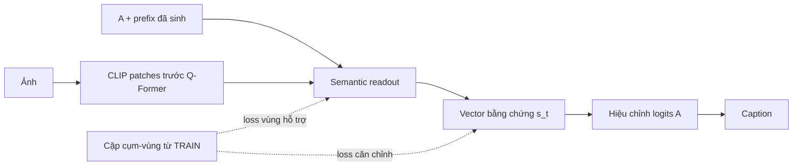

# Đề xuất: căn chỉnh cụm–vùng gắn với sinh caption

**Đây là phương pháp ứng viên có học căn chỉnh ngữ nghĩa tường minh.** Nó thay
P/Q thuần readout làm đề xuất chính. Chưa có implementation, kết quả hoặc novelty
đã được xác lập; không tự chuyển thành training.

## Làm gì?

Khi huấn luyện, một đối tượng được nhắc trong caption được ghép với vùng hỗ trợ
trong ảnh. Ví dụ, noun mention `bus` có một box được ghép chắc chắn; nếu reference
có modifier hợp lệ như `red bus`, có thể tạo phrase target giàu hơn. Cụm/vùng này
dạy một semantic readout, thay vì chỉ thưởng câu cuối hoặc học object presence.

Giữ toàn bộ A đóng băng. Từ prefix hiện có, readout chọn196 projected+ReLU patch
tokens trước Q-Former và trả vector s_t512 chiều. Vector được normalize và dùng
**đồng thời** để học semantic alignment và hiệu chỉnh logits qua vocabulary head
của A. Không có semantic-head riêng chỉ để nhận loss mà tách khỏi đường sinh.

## Học căn chỉnh bằng gì?

Phrase được frozen CLIP text encoder biến thành semantic target e_phi. Box
cung cấp support mask trên grid14×14. Căn chỉnh phải đạt **cả hai điều**:

- Attention có mass tại vùng của đối tượng được ghép.
- s_t gần nghĩa của **cùng phrase** được ghép với vùng đó.

Một prefix có thể có nhiều continuation đúng, nên target là tập các cặp
S(I,p)={(phrase,box)} từ5references có đúng prefix đó. Loss gom trên từng **cặp**,
không trộn nghĩa của cat với box toothbrush. Forward không nhìn phrase tương lai.

Với m_B là attention mass trong box và tau=.1:

\[
L_{align}=-\log\frac1{|S|}\sum_{(\phi,B)\in S}
m_B(a_t)\exp\left[-\frac{1-\cos(s_t,e_\phi)}{\tau}\right].
\]

Đây là positive-set alignment surrogate, không phải xác suất correctness đã
calibrate. Không có nhãn âm suy từ thiếu mention, reference khác hoặc action0.
Prefix không có target hợp lệ thì không nhận L_align; không được coi là false.

\[
L_{total}=L_{SCST}+0.1L_{KL\text{-anchor}}+0.05L_{align}.
\]

SCST dùng phân phối caption **sau** correction và reward đã pin của dự án.
KL neo A trên cùng sampled prefixes. Alignment dùng reference prefixes. Inference
chỉ cần ảnh/prompt/prefix, không phrase target, box, parser hoặc text teacher.

## Nguồn và phạm vi thực tế

Nguồn sẵn có:17.904 spans/5.602regions/4.495TRAINimages/71classes đã kiểm6payloadSHA.
**Chúng chỉ là noun heads/multiword names, không có sẵn17.904 full adjective phrases.**
Nguồn ghép tự động/weak, không human gold. Phần modifier cần derivation riêng từ
đúng human reference bằng parser cố định; chỉ direct prenominal adjectives liên
tục, không mở PP/relative/coordination/cardinality/negation. Báo số modifier targets
thật và fallback head-only. Pairing không chắc thì bỏ alignment target.

Pilot này là **căn chỉnh đối tượng/cụm danh từ–vùng ảnh**. Chưa nhận là căn chỉnh
quan hệ hay giải quyết scope holding, và không dùng V-COCO ride0 làm negatives.
CLIP text target không là visual verifier; CLIP patches vẫn có global context.

## Phần đóng góp ứng viên và phép kiểm

Thành phần đang đề xuất là joint positive-set semantic+spatial supervision trên
chính evidence value tham gia sinh câu, với prefix ambiguity được giữ bằng tập
cặp phù hợp thay vì đưa future word vào forward. Điểm này phải so với các prior;
chưa được gọi là thuật toán mới đã xác minh.

Đối chứng tối thiểu: cùng module655.360params, cùng init/data/lịch/SCST+KL; C không
có L_align, T có L_align. Cả hai so với A. Đề xuất500updates/arm trên2000TRAINimages,
khóaIDs trước modifier expansion, một seed/end-only. Không dùng atlas20 làm gate.

Muốn tiếp tục phải có caption gain soA vàC theo gate+.01/pairedCI cùng CHAIR/recall
safeguards, đồng thời báo support mass/semantic cosine/grounding riêng. Cần kiểm
phrase thật sự sinh ra: L_align thấp trên reference-prefix không chứng minh mọi
output word được grounded. Thiếu gain hoặc chỉ heatmap đẹp không là thành công.

## Kế thừa, không đổi tên thành mới

[Zhou etal., CVPR2020](https://arxiv.org/pdf/2004.00390) đã có grounding
regularization và caption learning/SCST. [Mavroudi etal., CVPR2022](https://openaccess.thecvf.com/content/CVPR2022/html/Mavroudi_Weakly-Supervised_Generation_and_Grounding_of_Visual_Descriptions_With_Conditional_Generative_CVPR_2022_paper.html)
đã nêu khó khăn khi attention chưa biết từ cần ground. Prototype attention/CSA,
phrase-region matching và contrastive learning cũng có tiền lệ. Một tên mới hoặc
thêm loss không tự đủ novelty cho paper.

So với lịch sử dự án: không classifier presence nhưG/S; không region-captionCE
nhưVG; không chỉ box attention nhưR; không template/preference nhưCE/CROSS; không
bank/cascade nhưCSA. Đây là **khác biệt thiết kế trong dự án**, chưa tự xác lập
originality trong literature. Xem METHOD_SPEC.md để review đầy đủ trước notebook.
